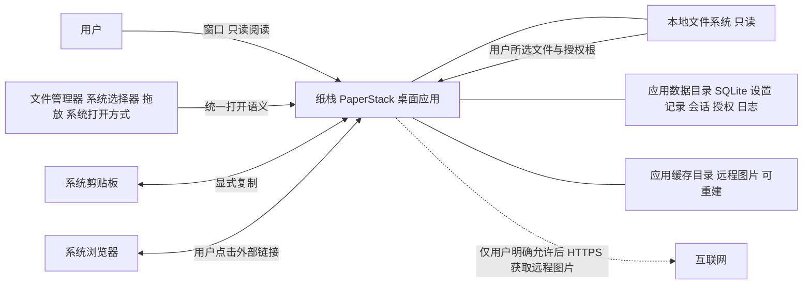
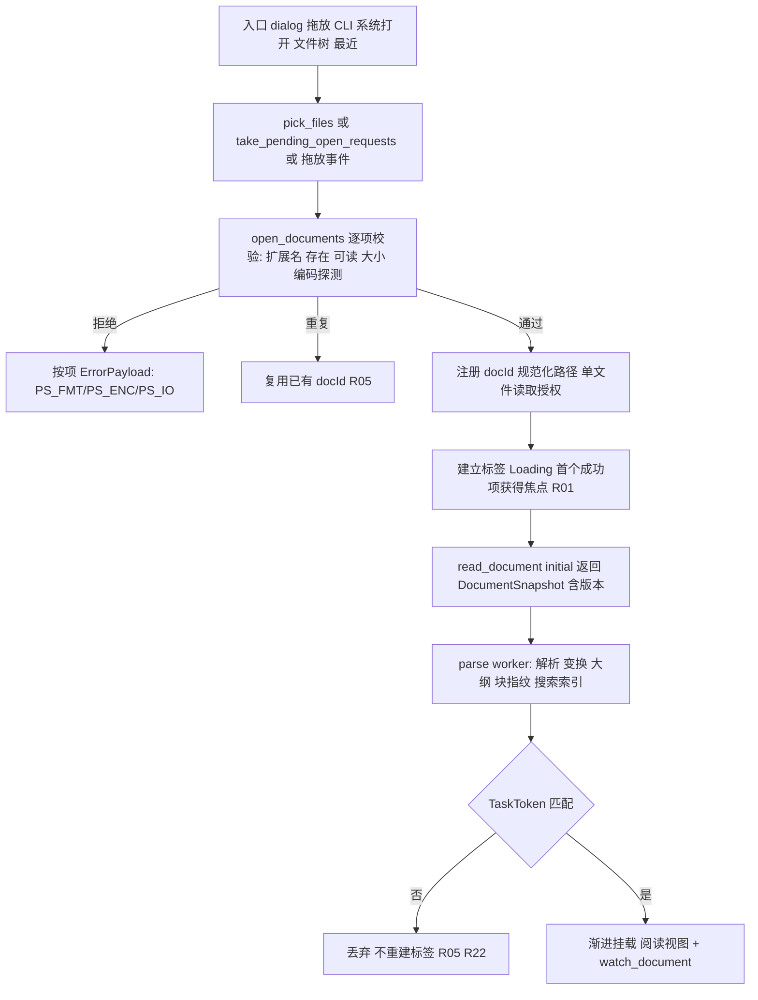
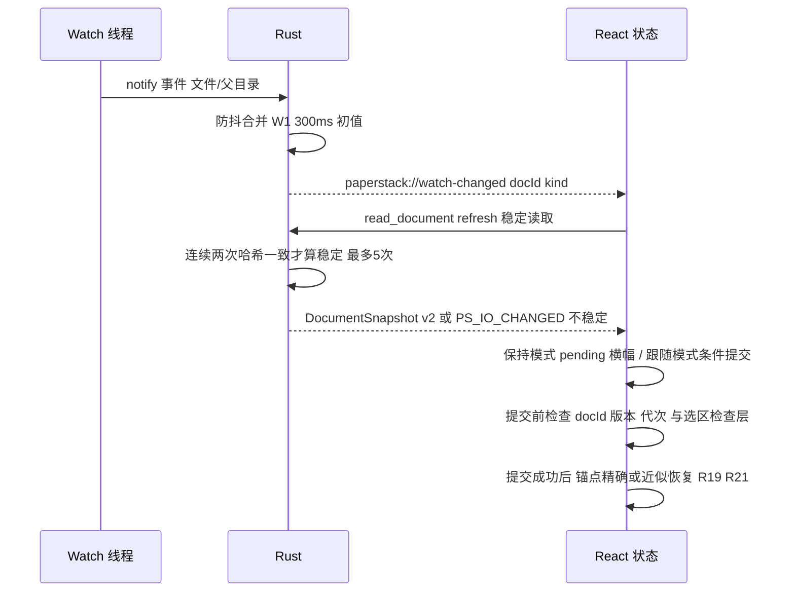
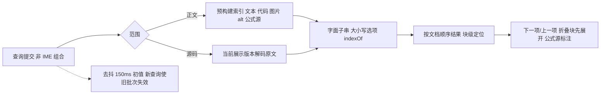
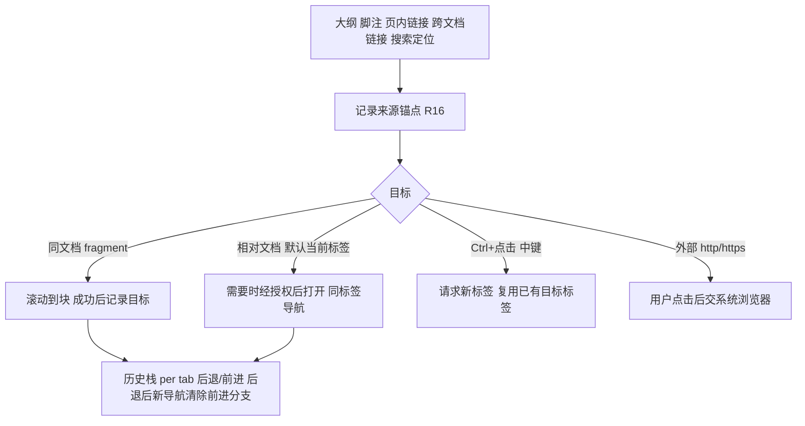
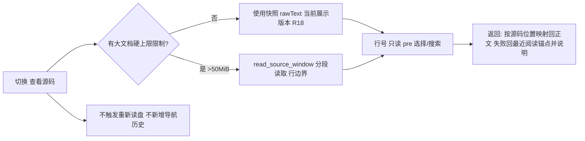
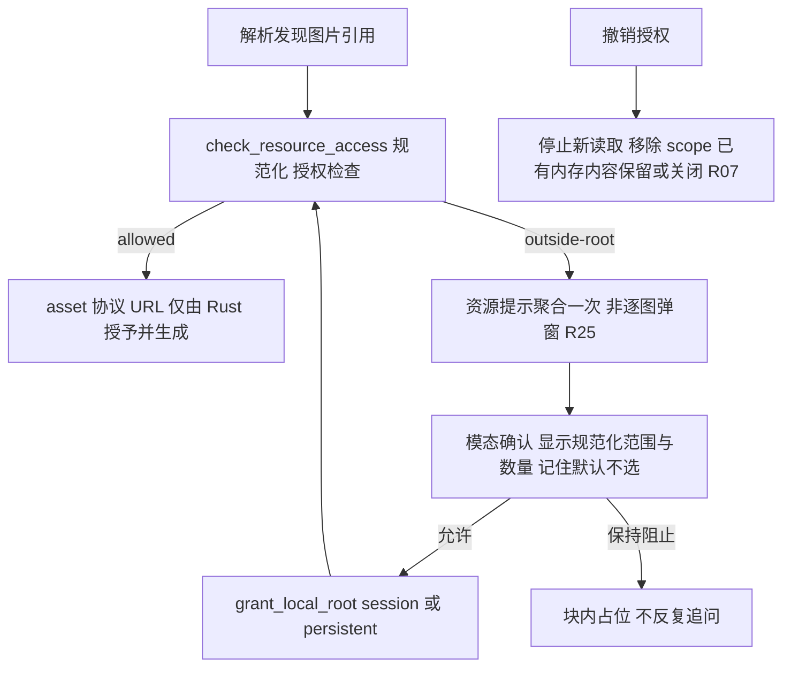
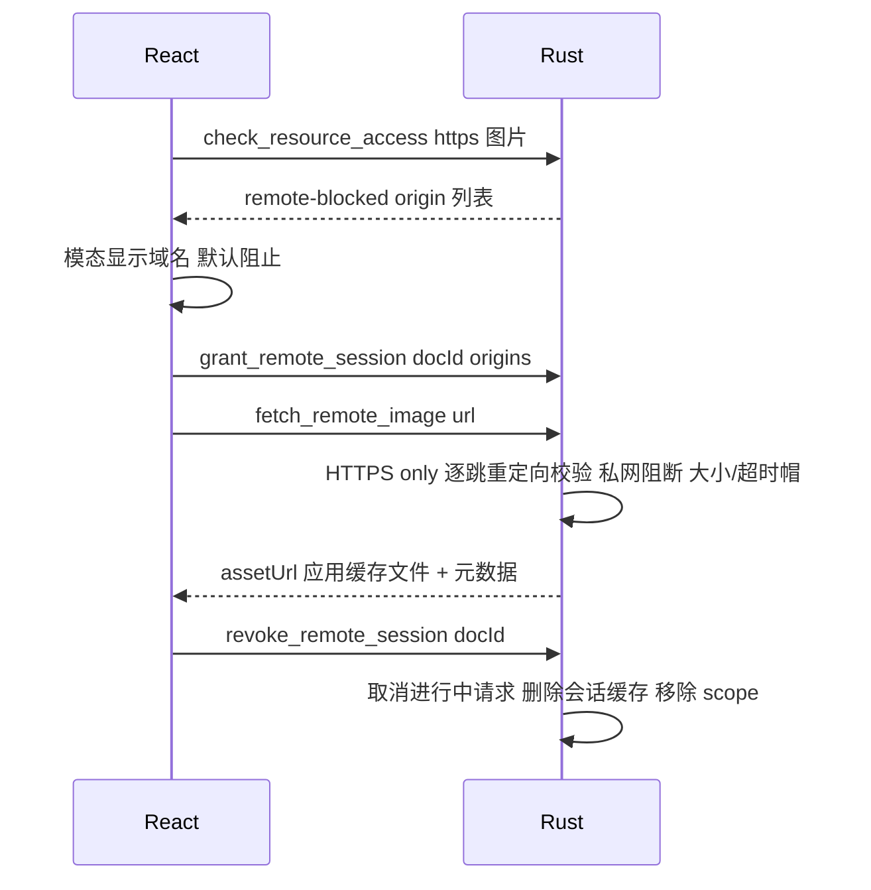
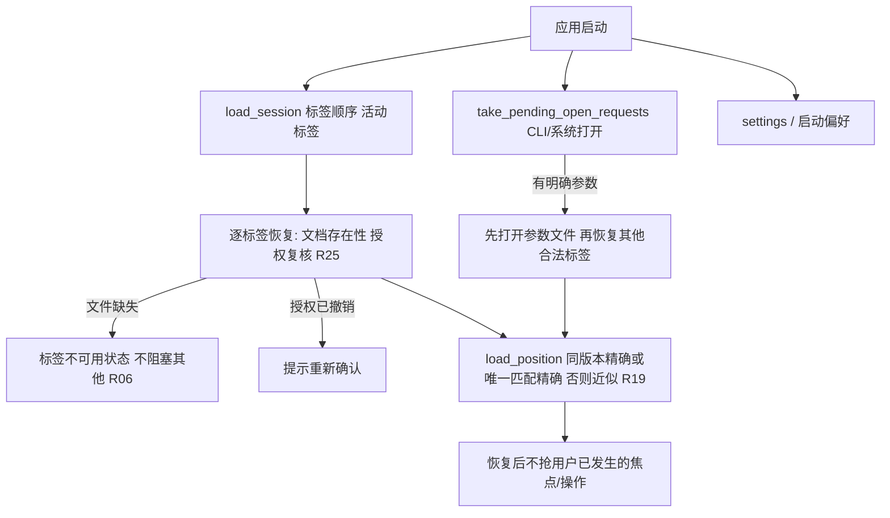
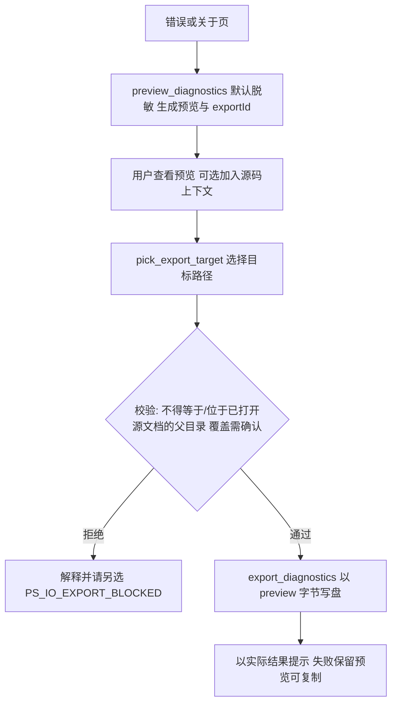

# 纸栈 PaperStack · v0.1.0 系统架构（System Architecture）

- **Producer**: agent:solution-architect
- **Artifact ID**: ART-30-ARCH
- **Artifact Type**: Architecture Description（系统上下文 / 模块结构 / 运行拓扑 / 关键流程 / 横切策略）
- **Status**: VALID
- **Revision**: 1
- **Owner**: solution-architect
- **Task**: `wp-03-architecture`（任务分支 `task/wp-03-architecture`；父分支 `feat/v0.1.0`；基线提交 `7b6f7338c75e4151cb0d684ef2e4a93bb6a9a64b`；产出提交主题 `docs(architecture): define v0.1.0 architecture and contracts`）
- **Last Verified**: 2026-10-07
- **Scope**: 仅 v0.1.0（Markdown 与数学公式只读阅读版）。不实现代码；不重新设计 UI（IXD PS-IXD-001 为界面权威）；不引入 v1.0 能力与占位入口（DR-07）。
- **IPC 契约**: `paperstack-ipc-r1`（见 `artifacts/30-architecture/contracts.md`）
- **Depends On**: `artifacts/20-requirements/requirements-baseline.md`（ART-20-RB，Rev 1）；`artifacts/10-intake/intake-report.md`（ART-10-INTAKE，Rev 1）；pinned 输入：计划书 V1.0（§3–§5）、SRS PS-SRS-001 V1.0（§3–§7、§10.2）、IXD PS-IXD-001 V1.0、`config/project.md`。
- **Downstream**: 详细设计、UI 规格、模型（状态/流程）、交付计划与任务分解、实现与测试任务、追溯矩阵。使用前按 Artifact Validation 检查修订与范围。
- **Sources**: 引用一律写明来源（计划书／SRS／IXD／config），禁用裸 `[S0x]`（ART-20-RB §1.4）。
- **Validation evidence**: 本文件所有需求引用可在 ART-20-RB 找到对应条目；模块结构逐行对齐计划书 §3.4；环境数字为 2026-10-07 本机实测（§12）；未修改 `input/`、`config/`、`state/`。

---

## 1. 系统上下文



- **进程与信任边界**：单个 Tauri 2 桌面进程（WebView + Rust 本地服务）。Rust 是唯一持有文件系统、网络与数据库能力的层；WebView 内运行不可信文档内容，只能通过 `paperstack-ipc-r1` 声明命令访问能力（SRS §3.1–§3.2；计划书 §3.3）。
- **无 Web 服务器**：不部署、不依赖开发服务器；正式包离线可读（计划书 §2.1、§5.6；NF02、R30）。
- **本地状态分层**：原始资料（只读）、应用持久数据（SQLite）、可重建缓存（目录）分别管理；清理不得删除用户原文件（计划书 §3.6；R27）。
- **网络默认零请求**：核心阅读不发起文档网络请求；远程图片仅当前文档会话经用户明确允许后受控获取（R26、NF02）。

## 2. 模块结构与职责

### 2.1 目录结构（对齐计划书 §3.4，新增项已标注）

```text
paperstack/
  src/
    app/                 应用入口、窗口与全局状态（含 i18n 引导、事件桥、根错误边界）
    components/          通用界面组件（不含业务规则）
    features/
      reader/            正文、目录、标签、导航、更新、位置、源码切换
      search/            页内搜索（正文/源码、大小写、结果导航）
      settings/          显示、更新、语法、隐私、关于、诊断界面
    document/            Markdown 解析、源映射与内容适配（纯函数；含 worker/ 与 adapters/）
    services/            受控原生接口的 TypeScript 封装（唯一 invoke/事件入口）
    styles/              主题、排版、组件样式令牌
    locales/zh-CN.json   界面文案资源包（新增；PC-06、ADR-009）
  src-tauri/
    src/
      commands/          对前端暴露的受限命令（薄层）
      services/          文件、授权、监测、资源、存储、诊断、会话
      models/            文档、版本、授权、设置、错误类型（serde）
    capabilities/        原生能力配置（最小权限；ADR-001、security-model §6）
    Cargo.toml / Cargo.lock / tauri.conf.json
  tests/  fixtures/  docs/  package.json  pnpm-lock.yaml  rust-toolchain.toml
  LICENSE  THIRD_PARTY_NOTICES.md  README.md
```

### 2.2 前端模块职责

| 模块 | 职责 | 关键约束/需求 |
|---|---|---|
| `src/app/` | 启动引导；创建全局 store（useReducer + Context，ADR-003）；桥接 Tauri 事件（watch/open-request）；窗口关闭→会话保存；主题令牌应用；i18n 初始化；根错误边界 | R05、R06、R22、R23、R24；ADR-003/009 |
| `src/components/` | 无业务规则的通用件：按钮、模态、抽屉、工具栏、状态行、焦点陷阱、图标、空状态 | R24；IXD §17.2；不引用 features |
| `src/features/reader/` | 标签栏与激活策略；阅读视图与渐进挂载；大纲/锚点；导航历史；更新横幅与提交规则；位置保存与恢复；源码视图切换；公式/代码/图表操作 UI；资源占位与放大层 | R05、R14–R16、R18–R22；IXD §4–§11 |
| `src/features/search/` | 查询提交（含 IME 组合等待）、去抖、范围/大小写选项、索引状态、结果导航与会话合并、`<mark>` 高亮 | R17；IXD §7；NF05；ADR-007 |
| `src/features/settings/` | 显示浮层与完整设置；语法/更新默认值；隐私清除与记录开关；关于与许可证/第三方声明；诊断查看与导出 UI | R23、R27、R28、R30；IXD §13–§15 |
| `src/document/` | 纯函数单管线（ADR-002）：解析、mdast/hast 变换、大纲与唯一锚点、块指纹、搜索索引、源映射、消毒 schema、按需渲染插件、大文档简化模式、格式适配器（仅 Markdown + 源码视图） | R08–R14、R17–R19、R29；计划书 §3.5；NF11 |
| `src/services/` | 类型化封装 `invoke`/事件；错误归一化为 `PaperStackError`；请求整形与取消令牌 | contracts.md §4–§5；R22 |
| `src/styles/` | CSS 变量主题令牌、中文排版、宽内容横向滚动、响应式回流 | R13、R23；IXD §3、§18 |
| `src/locales/` | `zh-CN.json` 界面文案；禁止硬编码自然语言 | PC-06；ADR-009 |

### 2.3 Rust 模块职责

| 模块 | 职责 | 关键约束/需求 |
|---|---|---|
| `commands/` | 校验入参、调用 service、`AppError → ErrorPayload` 映射；不含业务逻辑 | contracts.md；R25“令牌不得只由绝对路径替代” |
| `services/files` | 打开校验、读取、解码（UTF-8/BOM）、SHA-256、稳定性读取、重定位 | R01、R03、R07、R22；NF01 |
| `services/paths` | 规范化、canonicalize、授权根匹配、符号链接逃逸判定（security-model §2） | R25、NF03 |
| `services/auth` | 授权登记（文件/目录/远程会话）、撤销、启动复核、资产协议 scope 授予 | R25、R26；IX10 |
| `services/watch` | notify 订阅、防抖合并、替换保存检测、资源失效提示、事件发射 | R22；ADR-006 |
| `services/resources` | 受控远程获取（HTTPS、重定向、私网阻断、大小/超时）、缓存索引 | R26；NF02/03 |
| `services/storage` | SQLite（rusqlite bundled）连接、迁移、事务、写入门禁与分类清除 | R06、R19、R23、R27；NF08；ADR-004 |
| `services/session` | 最近/位置/会话/侧栏状态读写；记录抑制 | R06、R19、R20、R27 |
| `services/diagnostics` | 结构化日志、脱敏、预览与导出、受保护源位置校验 | R04、R28；NF01 |
| `services/app` | 启动参数队列、单实例移交、应用信息、合法文本资源 | R01、R30；ADR-008 |
| `models/` | IPC 数据结构与 `AppError`（thiserror）；serde camelCase；无 I/O | contracts.md §3、§5 |

## 3. 依赖规则（强制）

1. 前端依赖单向：`app → features → components`；`features/components → document|services|styles`；`document` 为纯模块，**不得** import `services`、`features`、`components`、`app`。
2. **UI → services → commands**：唯一 `invoke` 与事件监听入口在 `src/services/`；回调中不得内嵌业务/持久化逻辑（框架架构规则）。
3. Rust 依赖单向：`commands → services → models`；`models` 不依赖 services；跨服务调用经 `AppState` 显式注入。
4. 前端与后端各自独立实现，仅通过 `paperstack-ipc-r1` 通信；TS 不读取 Rust 内部结构，Rust 不解析 Markdown（计划书 §3.1）。
5. 禁止循环依赖；边界由评审与（实现阶段）lint 规则检查。
6. 重型解析只在 `document` 与 worker 内发生；React 组件只消费其输出。

## 4. 运行拓扑

| 运行时单元 | 说明 | 状态 |
|---|---|---|
| 主窗口 / WebView | 单窗口（v0.1.0 无多窗口、无托盘；计划书 §4.5） | WebView 内 React 树 |
| Tauri 主线程 | 窗口、命令分发 | `AppState` 受管状态 |
| Tauri 异步运行时 | 命令 async、watch 防抖、远程获取 | `spawn_blocking` 承载同步读盘/哈希/SQLite |
| 文件监测线程 | notify（inotify）自有线程 → mpsc → 异步防抖任务 → 事件 | `WatchService` 注册表 |
| 解析 Worker | 一个 Web Worker：mdast/hast/索引构建；任务带任务号可废弃 | `document/worker/parse.worker.ts` |
| SQLite | 单连接 + `Mutex`；WAL、`busy_timeout`、`foreign_keys=ON`；启动时迁移 | `Storage`（ADR-004） |
| 远程获取 | reqwest async；无 Cookie 持久化；会话级授权表 | `RemotePolicy`（R26） |

- **取消与失效**：所有跨层任务携带 `TaskToken {docId, version, generation}`；CLOSE/RELINK/REVOKE 递增代次并使旧任务失效（contracts.md §6；R22、R05）。
- **降级**：SQLite 失败进入内存降级（不静默丢状态，NF08）；Worker 初始化失败回退主线程解析并记诊断（ADR-002）。

## 5. 关键流程

### 5.1 打开（校验→解析→渲染）



### 5.2 文件更新（观测→稳定→待更新→提交/保持）



窗口重新聚焦触发复核（missed event 补偿）；资源文件单独变化由 `kind=resource` 事件失效对应图片（R22；ADR-006）。

### 5.3 搜索



搜索不写磁盘；查询仅内存（R20、SRS §6.1；NF05；ADR-007）。

### 5.4 导航与历史



失败或取消的导航不消耗历史；Esc 关闭搜索保留最后命中；一次搜索会话合并为一个历史项（R15、R16；IXD §6–§7）。

### 5.5 源码视图（同展示版本）



### 5.6 资源授权（本地）



### 5.7 远程图片（会话级允许→受控获取）



### 5.8 启动恢复



查询、选区、临时网络授权不恢复（R06、IX13）。

### 5.9 诊断导出



## 6. 状态所有权

| 状态 | 所有者 | 位置/媒介 | 生命周期 |
|---|---|---|---|
| 标签集合、活动标签、面板开合、更新策略、模态/提示 | 全局 store（useReducer + Context） | 内存 | 应用会话 |
| 每文档 UI 状态：状态机、展示版本、待更新、任务代次、选区/检查层、视图模式 | 文档会话 reducer | 内存 | 标签生命周期 |
| 重对象：rawText、hast、搜索索引、块/大纲注册表 | `DocumentModel` 模块级 Map（非 React state），键 `docId+version` | 内存，LRU ≤2 版本/文档 | 标签关闭即释放 |
| 滚动/焦点/DOM 引用、计时器、Worker 句柄 | refs / 模块单例 | 内存 | 组件/会话 |
| SQLite 连接 | Rust `Storage` | `Mutex<Connection>`，WAL | 进程 |
| 授权注册表、监测注册表、会话记录抑制标志、待处理打开请求 | Rust 受管状态 | `Mutex<…>` | 进程 |
| 设置、最近、位置、会话标签、侧栏状态、授权、缓存索引 | SQLite | 应用数据目录 | 持久（分类可清除；ADR-004） |
| 远程图片缓存文件 | 应用缓存目录 | 可重建，LRU 256MiB 上限 | 会话撤销/清除/重启 |

- **共享读取缓存不得共享选区或错误串用授权**（SRS §3.3）：`DocumentModel` 按版本共享只读数据；选区、历史、授权决策均按标签/文档独立。
- WebView `localStorage/sessionStorage` 不用于产品状态，防止第二份不受控持久化（NF08）。

## 7. 性能策略

- **异步解析**：解析管线在专用 Web Worker 运行（纯函数，可单测）；主线程只做 React 组件映射与渐进挂载；任务可废弃（代次）。Worker 失败回退主线程并记诊断（ADR-002）。
- **渐进挂载**：按块分片挂载（初始视口优先，其余空闲时间追加）；搜索索引先于 DOM 完成；未挂载块命中时优先挂载目标分片。v0.1.0 不做虚拟滚动（计划书 §5.7）。
- **按需重模块**：KaTeX、Shiki（按语言动态 import）、Mermaid（可见时渲染）均延迟加载；随包分发、不访问 CDN（R30、NF02）。
- **阈值**：>10MiB 或复杂度超预算 → 大文档提示（简化阅读/只读源码/取消）；>50MiB 不做全量渲染，仅 `read_source_window` 分段源码；单图 20MiB/32MP；Mermaid 节点/超时帽。均为初始安全预算，可实测校准（R29；SRS §6.1）。
- **内存**：每文档最多保留当前+上一版本重对象；关闭即释放；缓存 256MiB 上限 LRU；日志滚动 10MiB（R27、NF06）。
- **反馈**：操作 ≤100ms 先给明确状态；搜索去抖 + 旧批次隔离；进度不编造百分比（NF05；IXD §16.2）。
- **测量**：发布构建 + 固定输入/字体/WebView/缓存条件，各计时组 ≥30 次并报告失败（NF04–NF06；SRS §7 前言）；本机非基准机（§12）。

## 8. i18n

- 单代码库；所有界面文案抽取到 `src/locales/zh-CN.json`；代码仅调用 `t(key, params?)`（`src/app/i18n/`），支持点分命名空间与 `{name}` 插值；缺失键回退 `zh-CN` → 原样 key 并记开发警告（ADR-009；框架 i18n 规范；PC-06）。
- Rust 不返回用户可见文本：错误携带 `messageKey`（contracts.md §5），由前端解析语言包。
- 未来新增语言仅新增 `locales/{locale}.json` 并注册；不得分叉代码或逻辑（计划书 §2.1）。

## 9. 错误处理策略

- **统一错误束**：Rust `AppError`（thiserror）→ `ErrorPayload {code, category, messageKey, retryable, sourceRange?, details?}`；TS `services/ipc.ts` 归一化为 `PaperStackError`（contracts.md §5）。
- **错误分类展示**：高影响错误先示；非阻塞资源问题聚合到单一入口；不连续弹模态（SRS §6.3）。
- **局部隔离**：单块解析/公式/图表/图片失败 → 块级占位 + 诊断，不白屏（计划书 §5.6）。
- **未知错误**：给稳定错误编号与安全重试入口，不显示空白（R28）。
- **持久化失败**：内存可读、明确提示“可能无法保存”，不谎报“已保存”（R23、NF08）。
- **迟到结果**：一律按代次丢弃，不覆盖新状态（R22/AT22）。

## 10. 测试接缝

| 层次 | 手段 | 覆盖 |
|---|---|---|
| 纯函数 | vitest：`src/document/**`（解析、变换、索引、锚点、消毒、大文档规则） | NF11；R08–R14、R17–R19、R29 |
| 组件 | vitest + Testing Library + jsdom：交互、焦点、状态文案（不替代桌面验证） | R24；IXD |
| Rust 服务 | cargo test + tempfile：路径/授权算法、稳定性读取、存储迁移、清除、脱敏、远程策略纯函数 | R25–R28；NF03/08 |
| 契约 | 形状测试：TS 类型与 Rust serde 序列化样例双向断言（fixtures 中的 JSON 样例） | contracts.md；NF11 |
| 桌面 | 本机 X11 真实应用脚本化运行 + `xwd`/`ffmpeg` 截图（ADR-010）；WebDriver 不可用（§12） | DR-02–05；AT/IT 层 |
| 性能 | 发布构建、固定夹具、计时脚本（录入证据，未实测前不得宣称达标） | NF04–NF06 |

## 11. 构建与打包

- 前端：Vite 生产构建 → `dist/`（Tauri `frontendDist`）；字体/语法/图表资源全部随包（module import，不访问 CDN）。
- Rust：`cargo build --release`；`tauri build --bundles deb` 产出 `paperstack_0.1.0_amd64.deb`；产品标识 `com.quirkybrain.paperstack`，二进制/包名 ASCII `paperstack`，显示名“纸栈 PaperStack”（计划书 §1.5、§4.7；ADR-008）。
- 元数据：`package.json` 与 `Cargo.toml` 版本 0.1.0、authors Quirkybrain、license GPL-3.0-only；`packageManager` 锁定 pnpm；`rust-toolchain.toml` 锁定工具链；两锁文件入库（PC-10/11）。
- 许可：`LICENSE`（未改写 GPLv3 全文）与 `THIRD_PARTY_NOTICES.md` 作为 bundle resources 随包，关于页离线读取；匹配版本对应源码入口未配置时为发布阻塞（A9/NF12；ADR-008）。
- CSP 与能力：`tauri.conf.json` 配置生产 CSP 与 `devCsp`（HMR）；`capabilities/` 最小权限（security-model §6）。
- 离线验证：断网启动、打开、搜索、复制、图表/公式/代码渲染、关于页（R30、NF02；AT30/IT08）。

## 12. 环境约束（本机实测，2026-10-07）

| 项目 | 实测 | 架构影响 |
|---|---|---|
| 桌面会话 | `XDG_SESSION_TYPE=x11`，`DISPLAY=:1` 可用；无 Wayland 会话 | X11 真实运行/截图可做；**Wayland 验收 UNVERIFIED**（NF10/R30/IT08，DR-05；ADR-010） |
| WebDriver | 无 `WebKitWebDriver`/`tauri-driver`/`webkit2gtk-driver` 包；`sudo` 需密码不可非交互 | 不能安装驱动；E2E 改走真实应用脚本化 + 截图；WebDriver 路线保持为将来目标（ADR-010） |
| 自动化输入 | 无 `xdotool`；`libxdo` 开发头 `/usr/include/xdo.h` 与 `libxdo.so` 存在，但**无 `libxdo.pc`**（`pkg-config libxdo` 失败） | 构建辅助工具需直接链接 `-lxdo`（或本地 .pc 包装）；记为构建注意项（ADR-010） |
| 截图 | `xwd`、`ffmpeg` 可用；无 ImageMagick/scrot | 截图经 `xwd` → `ffmpeg` 转 PNG；固定窗口/字体/缩放条件（DR-03） |
| 前端工具链 | Node v24.15.0；pnpm **未安装**；Corepack 0.34.6 可用 | 经 `corepack enable`/`corepack prepare` 固定 pnpm；版本写入 `packageManager`（PC-11） |
| Rust | rustc/cargo 1.96.0；WebKitGTK 4.1（2.52.6）、GTK3 3.24.41 | 本机可构建与运行真实应用 |
| Git | 无远端；本地受守卫合并为唯一路径 | 不得写成已获平台批准（A10；本任务按本地流程） |
| 硬件 | 12 核；MemTotal ≈15.0 GiB；非计划书 §2.1 基准机（4 核/8GiB/SSD） | 性能数字不得以本机冒充基准机结果（SRS §7；A8） |

## 13. Open-Items（交 Stage Orchestrator，不直接向用户提问）

1. **A9 对应源码入口（发布阻塞）**：`get_app_info.legal.sourceEntryUrl` 缺省为 `null` 且带原因；发布前需所有者提供真实入口或由 Release Gate 记录阻塞（R30、NF12）。
2. **A4 Wayland 验收环境**：本机仅 X11；Wayland 侧 NF10/R30/IT08 保持 UNVERIFIED，需另行安排会话补验（DR-05）。
3. **`libxdo.pc` 缺失的工程处置**：辅助工具建议以 `build.rs` 探测 `xdo.h` + 直接 `-lxdo` 链接；若实现阶段确认需要系统级安装授权，按 A5 升级（当前不阻塞其余开发）。
4. **>50MiB 只读源码模式的边界确认**：本设计按 IX15“只读源码：以可控方式显示解码文本，不做重型渲染”实现分段读取；若产品期望 >50MiB 仅给硬上限，需在实现前确认（R29；SRS §6.1 可调整）。
5. **性能/可达性数字**：NF04–NF06、NF09 未实测，全部保持“待实测校准”；测试脚本与夹具在实现阶段建立（A8）。
