# 纸栈 PaperStack · v0.1.0 文档会话与版本语义模型（Session and Version Models）

- **Producer**: agent:system-modeler
- **Artifact ID**: ART-35-MODELS
- **Artifact Type**: Behavioral Models（状态机 / 序列 / 决策规则 / 测试不变量）
- **Status**: VALID
- **Revision**: 1
- **Owner**: system-modeler
- **Task**: `wp-04-models`（任务分支 `task/wp-04-models`；父分支 `feat/v0.1.0`；基线提交 `4d87b5e28d1a921ee7ff15761c1f30ccf6edb26c`；产出提交主题 `docs(models): formalize session and version semantics`）
- **Last Verified**: 2026-10-07
- **Contract**: `paperstack-ipc-r1`（`artifacts/30-architecture/contracts.md`）。本模型中的命令名、事件名、结构与字段一律取自该契约；模型不新增、不修改任何 IPC 接口。
- **Depends On**: `artifacts/20-requirements/requirements-baseline.md`（ART-20-RB Rev 1）；`artifacts/30-architecture/architecture.md`、`contracts.md`、`data-model.md`（均 Rev 1）；SRS PS-SRS-001 V1.0；IXD PS-IXD-001 V1.0。
- **Pinned Inputs（2026-10-07 本任务实测 SHA-256 与 `state/handoffs/wp-04-models.json` 一致）**：requirements-baseline `42784f67…`；architecture `50e1e588…`；contracts `30664dd9…`；data-model `0e263230…`；IXD `786096e3…`；SRS `c991164f…`。
- **Method**: 对 pinned 输入逐条抽取行为条款 → 建立状态/序列/决策模型 → 与 `paperstack-ipc-r1` §6/§7 交叉核对 → 输出可测试不变量（INV-*）与参数表；发现的不一致/缺口不静默处理，记入 §开放项。
- **效力与冲突规则**：本模型是 SRS/IXD 行为条款的规范化形式，不新增产品条款；冲突时以 SRS §1.3 规则统一原文后再作为验收依据，实现不得挑选较宽松条件。数值参数若来源未规定，一律标“待验证参数”并给建议初值，不构成验收阈值（A8）。
- **Downstream**: 实现（`src/features/reader|search`、`src/app`、Rust `services/watch|auth|storage`）、测试工程（本文件 INV-* 作为 oracle）、UI 规格、追溯矩阵。

## 0. 共同定义（全部模型共用）

### 0.1 会话与任务结构（字段名取自 contract §3.1、§6）

| 名称 | 定义 | 来源 |
|---|---|---|
| `DocumentSession`（每标签一个） | `{ docId, displayVersion, generation, pendingVersion?, status }` | contract §6.1 |
| `displayVersion` | 用户眼前版本的 `VersionInfo`（版本键 = `contentHash`，sha256 hex） | contract §3.1/§6；R22 |
| `observedVersion` | 最近一次稳定读取得到的磁盘观测版本（用于比较新旧，不直接展示） | R22“记录磁盘观测版本与展示版本” |
| `pendingVersion` | 已稳定观测、尚未提交展示的候选；`pendingVersion ≠ displayVersion` 时存在“有新版本”标记 | R21/IXD §10.1；contract §6 |
| `generation` | 代次，单调递增整数；任何“目标改变”（打开/重定位、接受新的待更新候选、关闭标签、撤销授权）时递增 | contract §6.1 |
| `TaskToken` | `{ docId, version: string \| null, generation, taskId }`；每个跨异步边界任务派发时携带 | contract §1.6/§6.2 |
| 提交（commit） | 把异步任务结果写入用户可见状态；必须通过 §2.1 提交条件 | contract §6.3 |
| 失效（invalidate） | 通过递增 `generation` 使旧任务不可提交；迟到结果必须丢弃 | contract §6.1/§6.5 |
| 版本绑定任务 | 解析/渲染/索引、资源解析、锚点恢复、源码窗口、诊断生成等与内容版本绑定的任务（`version ≠ null`） | contract §6.3 |

### 0.2 正交维度（SRS §6.3；IXD §16.1）

“文档存在性、展示版本、任务状态、资源状态和位置可信度是独立维度”。IXD §16.1 表中的 Update pending / Restricted resource / Simplified **不是**互斥生命周期状态，映射如下：

| 维度 | 取值 | 说明 |
|---|---|---|
| D1 生命周期 | Loading / Ready / LoadFailed / Unavailable（应用无标签时为 Empty） | 每标签唯一；见模型 1 |
| D2 版本 | `displayVersion` / `observedVersion` / `pendingVersion?` | 见模型 2 |
| D3 任务 | 每任务 `TaskToken` 的运行/完成/失效；`DocumentSession.status` 反映汇总 | contract §6 |
| D4 资源 | 每个资源键：未解析 / allowed / remote-blocked / outside-root / missing / unsupported / denied / limited | `AccessDecision`；R13/R25/R26 |
| D5 显示模式 | full / simplified / sourceWindow | R18/R29 |
| D6 局部诊断 | 按块/资源记录的 `DiagnosticIssue` 集合；不改变 D1 | R28；IXD §16.1 |
| D7 位置可信度 | exact / approximate | R19；IXD §16.1 |

正交性规则：任一维度的变化不得被单一“成功”标签覆盖；允许“正文可读＋有新版本＋远程图被阻止”同时成立（SRS §6.3）。错误优先级：高影响错误先显示，非阻塞资源问题汇总到一个可展开入口，不连续弹模态（SRS §6.3；IXD §16.2）。

引用与命名纪律：需求写 `R…/AT…`，交互写 `IXD §…`，契约写 `contract §…`；禁用裸 `[S0x]`（ART-20-RB §1.4）。前端内部模型（历史项、候选状态等）明确标注“非 IPC”，不得据此推断新命令或新字段。

## 1. 文档会话状态机（每标签）

覆盖：R01、R03、R07、R21、R29；AT01/AT03/AT07/AT21/AT29；IX01/IX08/IX09/IX15；SRS §6.3；IXD §16.1。

### 1.1 主生命周期状态图（D1）

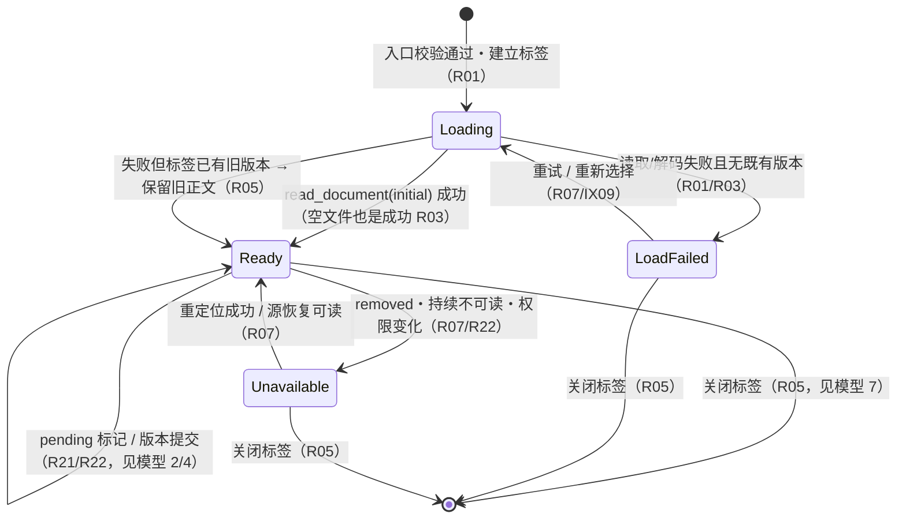

说明：`Simplified`（D5）与资源受限（D4）、局部诊断（D6）不进入本状态图；应用无任何标签时是 Empty，直接落在 UI00（R05/AT05）。

### 1.2 转换表

| # | 转换 | 条件 | 动作 | 用户可见结果 | 引用 |
|---|---|---|---|---|---|
| T1 | ∅ → Loading | 入口（dialog/drop/CLI/system/tree/recent）逐项校验通过并登记 docId | 建立标签，派发 `read_document(initial)`；>150ms 才显示轻量占位 | 新标签；占位；可取消 | R01；IX01 §4.2 |
| T2 | Loading → Ready | initial 读取成功（含 0 字节文件） | 渲染渐进内容；`watch_document` 注册；尝试 `load_position` | 正文（空文件显示“文档为空”）；位置恢复 | R03/R05/R19；AT03 |
| T3 | Loading → LoadFailed | 读取/解码失败（`PS_IO_*`/`PS_ENC_*`）且无既有版本 | 记录诊断；提供重试/重新选择/关闭 | 明确原因与恢复动作，不白屏 | R01/R03；IXD §4.2 表 |
| T4 | Loading → Ready（保留旧内容） | 重开或正文导航中读取失败但标签已有版本 | 不替换正文；显示错误入口 | 原正文保持；“加载失败不替换既有文档” | R05/R07；AT05 |
| T5 | Ready → Ready（提交） | 接受候选（显式“现在更新”或跟随条件满足，见模型 4） | 替换展示版本；恢复锚点；显示精确/近似文案 | 新内容＋位置结果 | R21/R22；AT21/AT22 |
| T6 | Ready → Ready（pending） | 稳定读取得到与展示不同的哈希 | 仅记录 `pendingVersion`；显示更新横幅 | 正文不变＋“文件已有新版本” | R21/R22；IXD §10.1 |
| T7 | Ready → Unavailable | `removed` 事件或稳定读取持续失败/权限变化 | 保留已加载内容；停止失败的更新读取；提供重定位/重试/关闭 | “找不到原文件…可能不是最新版本” | R07/R22；AT07；IXD §11.1 |
| T8 | Unavailable → Ready | 用户“重新定位”成功 或 源恢复可读 | 同字节 → `status="reassociated"` 同身份；异字节 → `status="new-version"` 同 `docId` 新版本；位置至多近似 | 先说明后采用；不伪装同版本 | R07；AT07；contract §2.1 |
| T9 | Ready → Ready（简化） | >10MiB 或复杂度超预算，用户选择“简化阅读” | 切换管线子集；保留全文文本、搜索、复制、源码视图；重型块显示源码 | 标注“简化阅读”与索引范围 | R29；AT29；IX15 |
| T10 | Ready → Ready（资源受限） | 资源缺失/越界/未允许/超限/解码失败 | 块内占位；聚合资源入口；不阻断正文 | 块内说明；“已阻止远程图片”等 | R13/R25/R26；IXD §9.3 |
| T11 | 任意 → ∅（含 Unavailable） | Ctrl+W/菜单/关闭标签 | 取消任务与监测；递增代次；释放重对象；激活顺序见模型 7 | 标签消失；迟到结果不重建标签；不创建同名文件、不格式化原文 | R05；AT05/IT04；R04/R07；AT04 |

### 1.3 不变量（测试 oracle）

- INV-DS-01 每个标签同一时刻恰有一个 D1 状态；应用无标签时显示 UI00（Empty），不存在“幽灵标签”。
- INV-DS-02 pending / 资源受限 / 简化 / 局部诊断可同时存在，且都不改变 D1；不得以单一“成功/失败”标签覆盖（SRS §6.3）。
- INV-DS-03 Loading 只能在“校验通过且标签建立”之后出现；校验失败不建立标签（R01）。
- INV-DS-04 空文件是成功读取：进入 Ready，正文为空并显示“文档为空”，不进入 LoadFailed（R03/AT03）。
- INV-DS-05 局部资源、公式、图表、代码块失败只改变 D4/D6，正文与其余块继续可读；不白屏（R09/R28）。
- INV-DS-06 Unavailable 必须保留最后展示版本的内容；不得清空正文、不得自动创建同名文件（R07/R04）。
- INV-DS-07 后台标签的错误与状态只影响该标签；前台阅读不受影响（IXD §11.3）。
- INV-DS-08 简化模式的“已呈现/已索引范围”说明必须准确；不得把部分渲染称为完整成功（R29/IX15）。

### 1.4 参数与来源

| 参数 | 值 | 来源 | 性质 |
|---|---|---|---|
| 轻量加载占位阈值 | >150ms 才显示 | IXD §4.2 | 设计初值 |
| 实际阶段文案阈值 | >1s 显示“正在读取/正在解析” | IXD §4.2 | 设计初值 |
| 大文档提示阈值 | >10MiB 或复杂度超预算 | SRS §6.1 | 冻结初始预算 |
| 硬上限（全量渲染） | >50MiB 不全量渲染，转源码窗口 | SRS §6.1 | 冻结初始预算 |

## 2. 版本/代次提交模型（R22/AT22）

覆盖：R22；AT22；IX08/IX09；contract §6（规范文本）、§7。

### 2.1 提交规则（规范，逐字承接 contract §6）

提交条件（结果 r 对标签 t 允许提交到用户可见状态，当且仅当三条件全部成立）：

| 条件 | 内容 |
|---|---|
| (a) | `r.token.docId == t.docId` |
| (b) | `r.token.generation == t.generation` |
| (c) | 对版本绑定的结果：`r.token.version == t 的当前目标版本`（`displayVersion`，或已接受的 `pendingVersion`——取该任务派发时的目标） |

派生规则（均来自 contract §6 与 IXD §10.2，不新增语义）：

1. 任何目标改变（打开/重定位、接受新的待更新候选、关闭标签、撤销授权）→ `generation++`；只增不减。
2. 过期结果一律丢弃；显示不得回退到更旧版本（§6.4）。
3. 取消/关闭/撤销授权通过递增代次使任务失效；迟到结果不得重建标签、重挂资源或覆盖新诊断（§6.5）。
4. 错误结果同样受 (a)(b)(c) 约束；陈旧错误不得覆盖新状态（§6.6）。
5. 连续候选合并为最新一个：晚派发先接受；早派发晚完成、且已有更晚候选被采用的旧结果丢弃（IXD §10.2 行 6）。
6. 同一 `contentHash` 的读取不构成“新版本”（pending 以哈希不同为准）。

### 2.2 序列图

**(a) 慢 v1 晚于 v2 完成（AT22 强制乱序）**

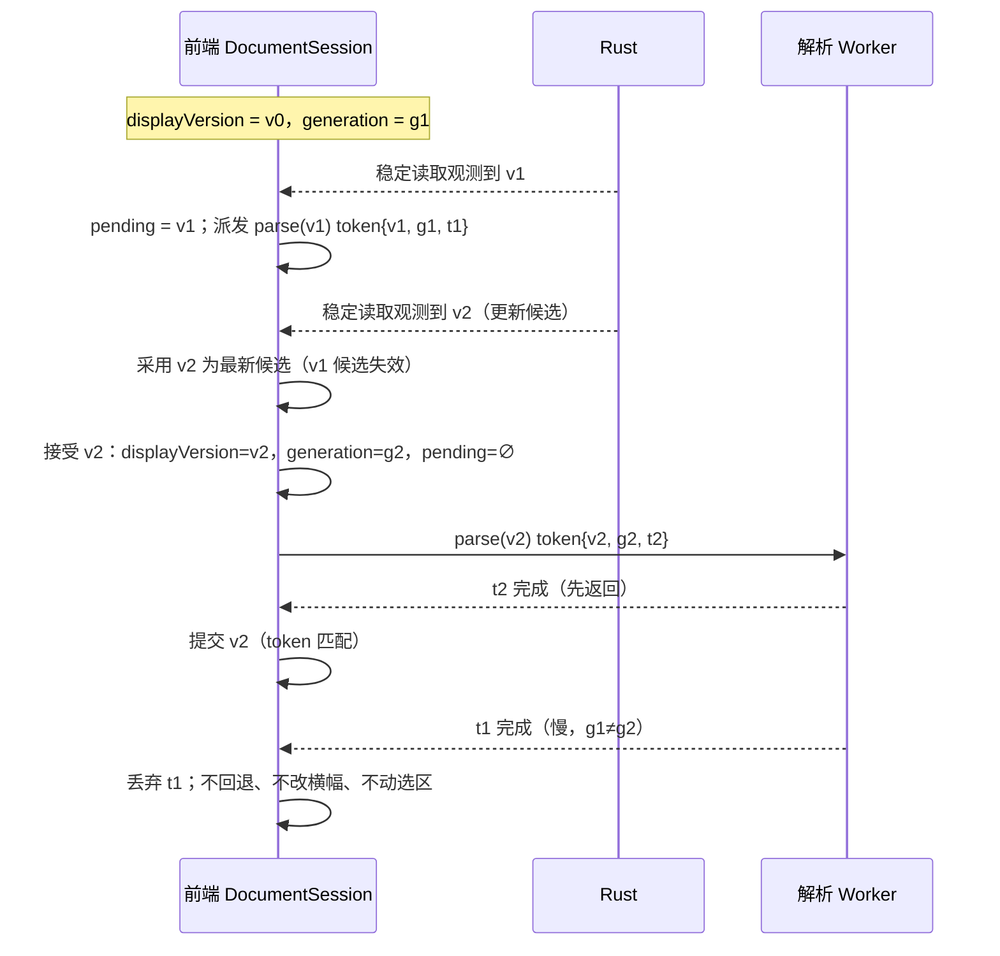

**(b) 替换保存（rename-over）**

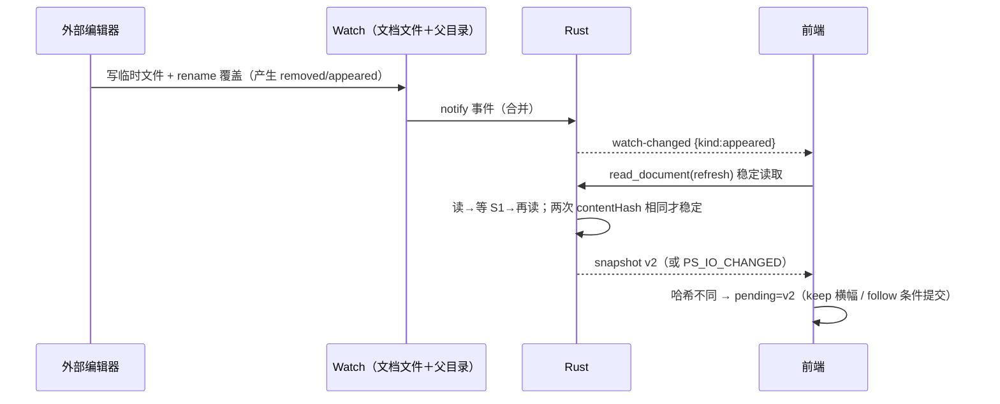

**(c) 关闭标签期间在途任务完成**

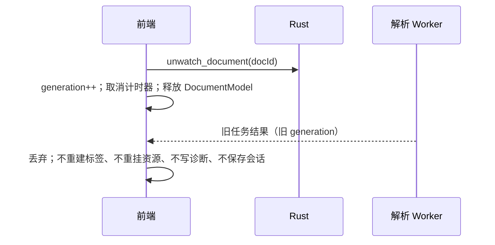

**(d) 撤销授权期间在途任务完成**

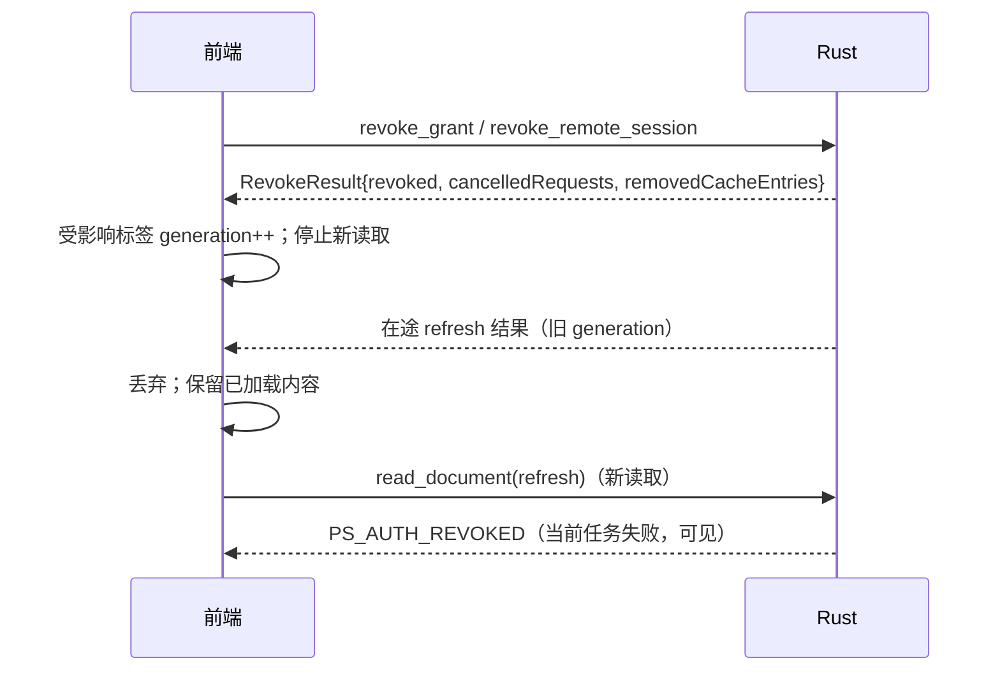

**(e) 仅图片变化**

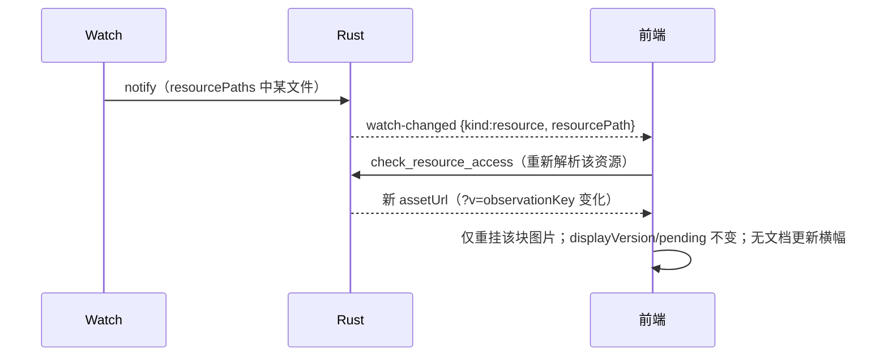

### 2.3 结果分类与拒绝时 UI 表现

| 结果类别 | 版本绑定 | 接受条件 | 拒绝（过期/不匹配）时 UI 表现 |
|---|---|---|---|
| 稳定读取发现（refresh/relink 读取） | 否（version=null，发现型） | (a)(b)＋候选合并规则 | 静默丢弃；不改内容/横幅/选区 |
| 解析/渲染/索引（展示提交与 pending 预取） | 是（当前展示目标或派发时候选） | (a)(b)(c)；接受候选时代次递增使旧预取失效 | 静默丢弃；不闪屏、不回退 |
| 资源解析 | 是 | (a)(b)(c) | 静默丢弃；占位维持 |
| 锚点恢复 / 源码窗口 / 源码搜索 / 诊断预览 | 是 | (a)(b)(c) | 静默丢弃；保留旧位置；过期预览不得导出 |
| 当前任务失败（代次匹配） | — | 条件 (a)(b) 成立 | 可见错误＋重试入口；`PS_IO_CHANGED` 表示不稳定 |

拒绝的语义：过期 ≠ 失败。丢弃必须无任何用户可见效果（无提示、无横幅变化、无选区变化、无滚动变化）；不得用错误提示表达陈旧（contract §6.4/§6.6；IXD §10.2“不虚构已同步”）。

### 2.4 不变量（测试 oracle）

- INV-VC-01 `displayVersion` 不回退：任何提交之后不可能观察到更旧的内容哈希（AT22 乱序用例）。
- INV-VC-02 提交当且仅当 (a)(b)(c) 全部成立；不满足时结果不得进入用户可见状态。
- INV-VC-03 `generation` 在每次目标改变时严格递增且只增不减。
- INV-VC-04 被丢弃结果零可见影响：内容、横幅、选区、滚动、诊断均不变。
- INV-VC-05 `pendingVersion ≠ displayVersion` ⇔ “有新版本”标记可见；`pendingVersion = ∅` 时该标记不可见。
- INV-VC-06 迟到结果不得重建已关闭标签、重挂资源、写会话或复活计时器（AT22/IT04）。
- INV-VC-07 资源单独变化（kind=resource）不改变 `displayVersion`、不产生文档更新横幅。
- INV-VC-08 相同 `contentHash` 的重复读取不产生 pending、不产生横幅。
- INV-VC-09 晚完成、早派发的候选结果不得覆盖更新的 pending 候选。
- INV-VC-10 当前任务的失败必须可见并可重试；过期任务的失败必须不可见。
- INV-VC-11 更新提交与其位置恢复结果（精确/近似）同属一次提交动作，必须成对出现且引用同一代次。

### 2.5 参数与来源

| 参数 | 值 | 来源 | 性质 |
|---|---|---|---|
| 稳定复读间隔 S1；重试上限 N | 150ms；5 | contract §7.4 | 初始可校准 |
| 加载占位阈值 | >150ms | IXD §4.2 | 设计初值 |

## 3. 监测/稳定/复核模型（R21/R22）

覆盖：R22；contract §7（规范文本）；ADR-006；IXD §10.3。

### 3.1 状态图

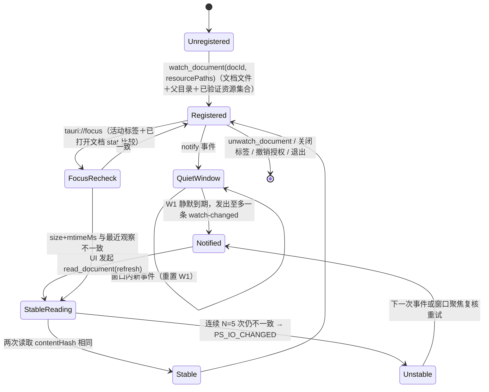

### 3.2 决策/转换表

| # | 事件/条件 | 动作 | 用户可见结果 | 引用 |
|---|---|---|---|---|
| W1 | `notify` 到达 | 按 docId 合并；W1 内至多一条 `watch-changed`；新事件重置计数 | 无（提示性事件，不带内容） | contract §7.2–7.3 |
| W2 | `kind=modified` | UI 触发稳定读取 | 稳定后按更新模式处理 | R22；IXD §10.2 |
| W3 | `kind=removed` | 稳定读取失败 → Unavailable | “可能不是最新”；重定位 | R07；IXD §11.1 |
| W4 | `kind=appeared`（替换保存） | 稳定读取；比哈希 | 同哈希 → 无 pending；异哈希 → pending | R22/AT22 |
| W5 | `kind=resource` | 重新解析对应资源；`?v=` 观察键变化 | 仅该块资源刷新 | contract §7.6；IXD §10.3 |
| W6 | 稳定读取 | 读→等 S1→再读；相同才稳定；最多 N=5 次 | 不稳定：保留旧内容＋原因/重试 | R22；contract §7.4 |
| W7 | 窗口聚焦 | 活动标签＋已打开文档比较 stat；不一致触发稳定读取 | 后台结果只暂存，激活后处理 | contract §7.5；R21 |
| W8 | 关闭标签/unwatch/撤销/退出 | 移除注册与计时器；在途任务失效 | 不再有任何事件 | contract §7.7；R05 |
| W9 | 资源集合变化 | 前端以最新集合重新 `watch_document`（整体替换） | 无 | contract §7.1 |

### 3.3 不变量（测试 oracle）

- INV-WS-01 只有已注册 `docId` 可能收到 `watch-changed`；关闭/unwatch 后不得再收到。
- INV-WS-02 同一 `docId` 在每个静默窗口 W1 内至多发出一条 `watch-changed`；窗口内新事件重置窗口。
- INV-WS-03 `watch-changed` 载荷不含正文内容，仅 `{docId, kind, resourcePath?, observedAtMs}`。
- INV-WS-04 稳定判定的唯一依据是两次 `contentHash` 相同；不稳定时展示版本不变。
- INV-WS-05 稳定读取重试不超过 N=5；仍不稳定必须返回 `PS_IO_CHANGED`，不得伪造稳定成功。
- INV-WS-06 聚焦复核只触发读取路径；提交仍受 §2 提交规则与模型 4 更新模式约束。
- INV-WS-07 `resource` 事件只影响对应资源键；不得重建整篇或改变文档版本。
- INV-WS-08 关闭/撤销/退出必须移除注册与计时器，且迟到结果不可提交。

### 3.4 参数与来源

| 参数 | 值 | 来源 | 性质 |
|---|---|---|---|
| 通知合并静默窗口 W1 | 300ms 初值 | contract §7.2 | 初始可校准（测试固定后作为回归依据，NF11） |
| 稳定复读间隔 S1 | 150ms 初值 | contract §7.4 | 初始可校准 |
| 稳定重试上限 N | 5 | contract §7.4 | 初始可校准 |
| 焦点复核触发 | 窗口 `focus` 事件；无独立计时 | contract §7.5 | 规范 |
| 焦点复核节流 | 待验证参数；建议 300ms | 来源未规定 | 待验证（理由：防止焦点抖动引发重复 stat/读取风暴） |

## 4. 更新模式（R21/IX08 §10.2）

覆盖：R21；AT21；IXD §10.2/§16.2；SRS §6.1（默认值）。

### 4.1 决策流程图

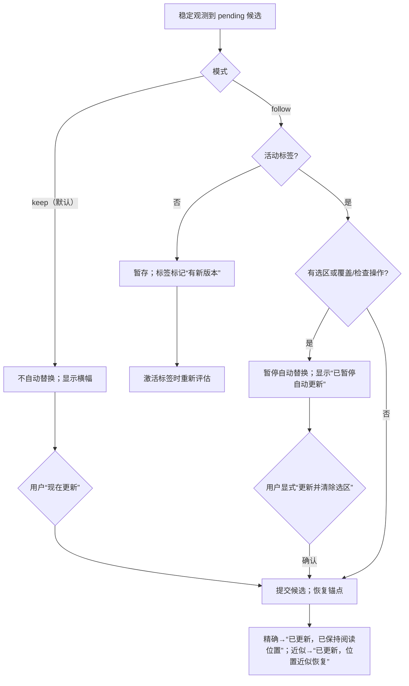

### 4.2 决策/转换表（逐条承接 IXD §10.2）

| 情形 | 条件 | 动作 | 用户可见结果 | 引用 |
|---|---|---|---|---|
| 保持模式 | 模式=keep | 不自动替换 | 当前内容＋“文件已有新版本。你正在阅读的内容未改变。” | R21；IXD §10.1 |
| 跟随・可提交 | 活动标签 ∧ 无选区 ∧ 无覆盖/检查操作 | 渲染并提交匹配版本，恢复锚点 | 精确/近似位置文案 | R21；IXD §10.2 行 2 |
| 跟随・暂停 | 存在选区或检查层 | 暂存候选；条件解除后重新评估 | “为保留当前操作，已暂停自动更新”（选区场景：“为保留选中文本…”） | R21；IXD §10.2 行 3/§16.2 |
| 跟随・后台 | 标签在后台 | 暂存；激活后再次检查 | 标签标“有新版本”，不抢焦点 | R21；IXD §10.2 行 4 |
| 显式更新（有选区） | 用户点击明确动作 | 提交并清除选区 | 按钮文字“更新并清除选区”；不出现含糊“确定” | R21；IXD §10.2 行 5 |
| 候选更替 | 处理 v2 时又观测到 v3 | 旧候选结果失效，只处理最新 | 不出现 v2 晚到覆盖 v3；不虚构已同步 | R22；IXD §10.2 行 6 |
| 不稳定/不可读 | 稳定读取失败 | 保留原展示版本 | 实际原因＋重试入口 | R22；IXD §10.2 行 7 |
| “稍后” | 用户点击 | 只折叠横幅；保留有文字的更新标记 | 文件名/标签保留“有新版本”，可再次展开 | R21；IXD §10.1 |
| 连续新版本 | 多次观测 | 合并为最新候选 | 不堆叠横幅/重复通知 | IXD §10.1 |

### 4.3 什么会清除/重置 pending 候选

| 触发 | 对 pending 的影响 | 引用 |
|---|---|---|
| 提交（手动或跟随） | pending=∅；displayVersion=候选版本 | R21/R22 |
| 稳定观测哈希 == displayVersion 哈希 | pending=∅（不显示“有新版本”） | 派生自“新版本=哈希不同”；INV-VC-08 |
| 更新的候选产生（v3 替换 v2） | 旧候选失效，仅保留最新 | IXD §10.2 行 6 |
| 关闭标签 | 会话销毁 | R05 |
| 重定位（relink） | 用户显式采用读取结果，按新展示版本处理 | R07；contract §2.1 |
| 选区/检查层出现 | 不清除；暂停自动提交，保留候选 | R21 |
| 后台标签 | 不清除；暂存待激活 | R21 |
| 源不可用/撤销授权 | 不清除已稳定候选（见 §开放项 OI-05）；停止新读取 | R07/R25 |

### 4.4 不变量（测试 oracle）

- INV-UM-01 默认模式为 keep：未显式改为 follow 时，任何外部更新不得自动替换正文（SRS §6.1）。
- INV-UM-02 follow 自动提交要求“活动标签 ∧ 无选区 ∧ 无覆盖/检查操作”同时成立；任一不成立即暂存。
- INV-UM-03 存在选区时自动更新永不发生；仅显式“更新并清除选区”可提交并清除选区（AT21）。
- INV-UM-04 后台标签不得在未激活时提交或抢焦点；激活时重新评估条件。
- INV-UM-05 “稍后”只折叠横幅；pending 与更新入口保持可用。
- INV-UM-06 连续候选合并为一个，不堆叠横幅/通知。
- INV-UM-07 文档级更新模式覆盖仅内存、仅当前文档会话；重启不继承（SRS §6.1；IXD §14.2）。
- INV-UM-08 提交后必须给出位置结果：精确→“已更新，已保持阅读位置”；近似→“已更新，位置近似恢复”。

### 4.5 参数与来源

| 参数 | 值 | 来源 | 性质 |
|---|---|---|---|
| 更新默认模式 | keep | SRS §6.1 | 冻结默认 |
| 反馈过渡时长 | 普通过渡 120–160ms；成功提示短暂不抢焦点 | IXD §18.3 | 设计初值 |

## 5. 导航历史模型（R16/IX03 §6）

覆盖：R16；AT16；IXD §6/§7；SRS §5.2；`open_documents` 复用语义（contract §2.1）。

### 5.1 每标签历史结构（前端内部模型，非 IPC）

- 每标签独立：`back` 栈与 `forward` 栈；历史项 `{entryId, kind, from: {docId, anchor}, to: {docId, anchor}, committedAt}`。
- `kind ∈ {outline, footnote, fragment, document-link, search}`。
- 失败/取消不产生项；后退后新导航清空 `forward`。

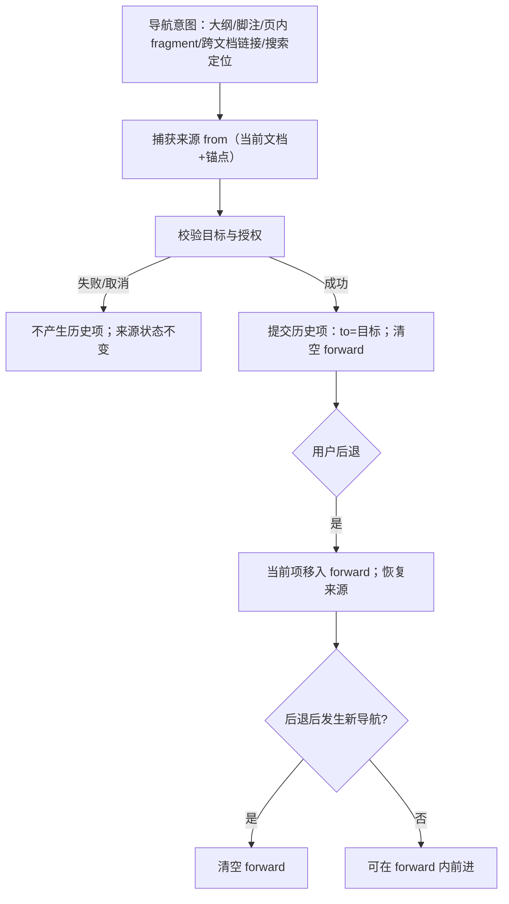

### 5.2 触发矩阵

| 触发 | 动作 | 历史效果 | 用户可见结果 | 引用 |
|---|---|---|---|---|
| 大纲/标题锚点 | 记录来源→跳转 | 成功 1 项；失败 0 项 | 当前章节标记跟随；焦点不动 | R14/R16；AT14 |
| 脚注链接 | 跳到注释；返回链接/Alt+左回引用 | 成功 1 项 | 同注释多处引用需回具体引用处 | R16；IXD §6.2 |
| 页内 fragment | 只跳当前文档 | 成功 1 项 | 缺失 fragment：同页保持位置并说明 | R14/R15 |
| 搜索会话 | 打开条时捕获来源；首次显式定位建立项；后续下一项更新该项 `to` | 整个会话至多 1 项；未定位 0 项 | Esc 保留最后命中位置；Alt+左回搜索前 | R16/R17；IXD §7.2 |
| 跨文档相对链接 | 默认当前标签导航（即使其他标签显示目标） | 成功 1 项；保留来源历史 | 目标不可用则展示可恢复状态 | R15/R16；SRS §5.2 |
| Ctrl+点击/中键 | 请求新标签；目标已有普通标签则复用 | 原标签历史不变 | 原标签位置不变 | R15；IXD §5.3 |
| 外部 http/https / 不支持的本地文件 / 危险协议 | 交系统浏览器 / 说明或阻止 | 0 项 | 保留来源；无“忽略安全”入口 | R15；IXD §6.3 |
| 普通滚动 / 主题 / 设置 / 标签切换 / 源码视图切换 / 失败或取消 | 无 | 0 项 | 来源状态保持；滚动与视图切换不产生历史 | R16/R18；SRS §5.2 |
| 后退（有旧版本在内存） | 恢复可信旧视图 | 项移入 forward | 保持旧版标识 | R16；IXD §6.4 |
| 后退（仅剩当前磁盘版本） | 在当前可读版本定位 | 项移入 forward | 唯一匹配→“已恢复阅读位置”；否则“文档已更新，已恢复到相近章节” | R16/R19；IXD §6.4 |

### 5.3 不变量（测试 oracle）

- INV-NH-01 历史按标签隔离；一个标签的导航不改变其他标签历史（AT05/AT16）。
- INV-NH-02 每次成功导航恰好产生 1 条历史项；失败或取消产生 0 条。
- INV-NH-03 普通滚动、主题/设置变化、标签切换、源码视图切换、更新提交都不产生历史项。
- INV-NH-04 后退后发生新导航必须清空 forward；后退本身不清空。
- INV-NH-05 一个页内搜索会话至多 1 条历史项，其 `to` 为最后一次显式定位；未定位则 0 条。
- INV-NH-06 跨文件导航默认作用于当前标签；显式新标签请求复用已有目标标签，不改动原标签历史与位置。
- INV-NH-07 无可后退/前进时入口禁用并说明原因；快捷键不产生动作。
- INV-NH-08 返回定位只允许在当前可读版本内进行；仅唯一可靠匹配可称精确，否则标近似。

### 5.4 参数与来源

| 参数 | 值 | 来源 | 性质 |
|---|---|---|---|
| 每标签历史容量上限 | 待验证参数；建议 100 条/标签，超出丢弃最旧项 | 来源未规定（R16 未给数值） | 待验证（理由：与最近列表同量级、内存可控；若确认不限则删除） |
| 搜索查询去抖初值 | 150ms | architecture §5.3 | 初始可校准 |

## 6. 锚点保存/恢复模型（R19）

覆盖：R19；AT19；data-model §3.3；contract §3.4；IXD §6.4/§10.3/§16.2。

### 6.1 记录格式（`AnchorRecord`，contract §3.4/data-model §3.3）

| 字段 | 含义 | 约束 |
|---|---|---|
| `versionHash` | 记录时的 `contentHash` | 用于判断同版本/跨版本 |
| `headingPath` | 标题路径字符串数组；`[]`=文档顶部 | 与大纲变换同源 |
| `blockFingerprint` | `"fp1:" + sha256(blockSearchText)[..16]` | `blockSearchText` 仅 LF 归一，与搜索索引同源 |
| `offsetRatio` | 块内比例 0..1 | 用于块内位置 |
| `sourceRange` | 记录版本中的 UTF-8 字节范围 `{startByte,endByte}` | 半开区间 |

纪律：不默认持久保存全文或原句片段（R19；SRS §6.2）；`rememberRecords=false` 时只维持内存位置。

### 6.2 恢复决策树

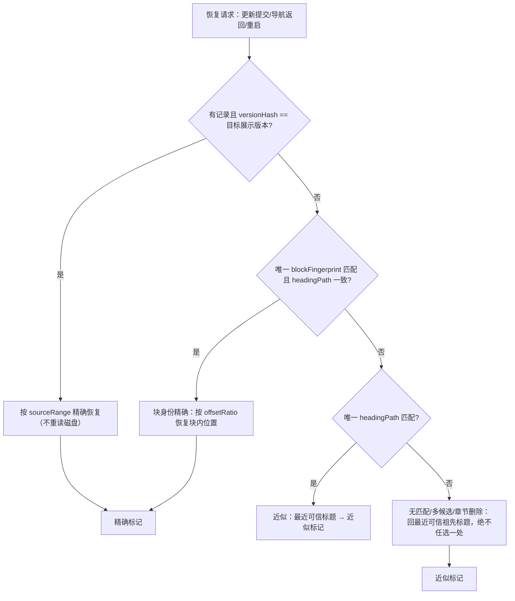

### 6.3 决策表与用户文案

| 情形 | 判定 | 动作 | 用户可见文案 | 引用 |
|---|---|---|---|---|
| 同版本 | `versionHash == 目标展示版本哈希` | `sourceRange` 精确恢复 | 更新流不适用（无版本变化）；返回/重启静默 | R19 |
| 跨版本・唯一块匹配 | 唯一 `blockFingerprint` ∧ `headingPath` 一致 | 块身份精确；`offsetRatio` 定块内位置 | “已更新，已保持阅读位置” | R19；IXD §10.3 |
| 跨版本・仅标题路径 | 无指纹匹配，但标题路径唯一 | 定位到该标题 | 近似文案 | R19 |
| 歧义/多候选/章节删除 | 匹配不唯一 | 回最近可信标题 | 近似文案；绝不称精确 | R19；SRS §5.1 |
| 完全无匹配 | 无可靠标题/指纹 | 回文档顶部或最近可信祖先标题 | 近似文案 | R19 |
| 历史返回・旧版在内存 | 旧快照可用 | 恢复旧版可信视图＋旧版标识 | “已恢复阅读位置” | IXD §6.4 |
| 历史返回・仅磁盘新版 | 唯一匹配 | 在当前可读版本定位 | 唯一匹配→精确；否则“文档已更新，已恢复到相近章节” | R16/R19；IXD §6.4 |
| 布局变化（字体/宽度/图片） | 上次布局变化 | ≤1 次稳定校正到当前锚点块 | 无连续动画/自动滚动 | R19；IXD §9.1/§18.3 |

### 6.4 不变量（测试 oracle）

- INV-AR-01 记录只含 `versionHash/headingPath/blockFingerprint/offsetRatio/sourceRange`，不含正文/原句；查询与选区不写磁盘（SRS §6.2）。
- INV-AR-02 同版本恢复必须使用 `sourceRange` 且不发起磁盘重读。
- INV-AR-03 跨版本“精确”当且仅当块指纹唯一匹配且 `headingPath` 一致；重复段落/多候选/章节删除时最高只能近似。
- INV-AR-04 近似恢复必须落在最近可信标题并显示对应文案；不得任选一个疑似块称精确。
- INV-AR-05 字体/宽度/图片变化后的稳定校正 ≤1 次；禁止连续自动滚动。
- INV-AR-06 位置保存不写源文件；抑制时返回 `SaveResult{saved:false}` 且不产生错误（R27/data-model §6）。
- INV-AR-07 保存失败必须可见（“本次位置未能保存，下次可能无法恢复”）且可重试；不得谎报成功（NF08）。
- INV-AR-08 `rememberRecords=false` 时仅维持内存位置；关闭/重启不恢复新记录（R19/R06）。

### 6.5 参数与来源

| 参数 | 值 | 来源 | 性质 |
|---|---|---|---|
| 滚动保存去抖 | ≥500ms | data-model §3.3 | 规范（下限） |
| 位置写入节流 | ≥2s | data-model §3.3 | 规范（下限） |
| 布局稳定校正次数 | ≤1 次/布局变化 | R19；IXD §9.1 | 规范 |
| 稳定校正执行延迟 | 待验证参数；建议 200ms（100–300ms） | 来源未规定 | 待验证（理由：等待重排/字体/图片解码稳定，避免与校正竞争） |

## 7. 标签生命周期（R05）

覆盖：R05；AT05；IXD §5.3；SRS §5.2/§6.1；contract §2.1。

### 7.1 状态图

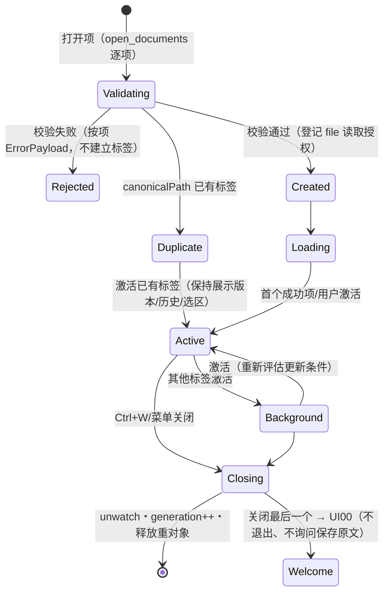

### 7.2 决策/转换表

| 操作 | 条件 | 动作 | 用户可见结果 | 引用 |
|---|---|---|---|---|
| 直接打开/文件树/最近打开 | canonicalPath 已有普通标签 | 复用并激活；不新建 | 保持已有展示版本；新内容按更新流程处理 | R05；SRS §5.2；IXD §5.3 |
| 直接打开/文件树 | 无既有标签 | 校验通过后建立 Loading 标签 | 新标签；首个成功项获焦点 | R01/R05；AT01/AT05 |
| 正文链接到已开文档 | 默认 | 当前标签导航 | 与其他视图历史/选区/更新独立 | R15；IXD §5.3 |
| Ctrl+点击/中键 | 目标已有普通标签 | 复用该目标标签 | 原标签位置不变 | SRS §5.2；IXD §5.3 |
| 同名不同目录 | 显示名冲突 | 标签显示最短区别父目录 | 悬浮/焦点可见完整路径 | R05；IXD §5.3 |
| 关闭非当前标签 | — | 仅关闭该标签 | 当前正文与焦点不动 | IXD §5.3 |
| 关闭当前标签 | 存在其他标签 | 激活顺序：MRU → 右邻 → 左邻 | 激活最近使用；无记录取右邻再左邻 | R05；AT05 |
| 关闭最后标签 | — | 回 UI00 | 应用不退出、不询问保存原文 | R05/AT05 |
| 关闭任意标签 | — | 取消任务、unwatch、释放 DocumentModel | 迟到结果不重建标签 | R05；IT04 |
| 标签栏显示 | 标签数 ≥2 | 显示标签栏 | 单标签隐藏标签栏 | SRS §6.1 |

### 7.3 不变量（测试 oracle）

- INV-TL-01 canonicalPath 相同的直接打开/文件树/最近入口复用同一标签，不新增标签。
- INV-TL-02 复用标签保持其展示版本、历史、选区与位置；新内容只经更新流程处理。
- INV-TL-03 同名不同目录必须显示最短区别父目录，且完整路径可达。
- INV-TL-04 关闭当前标签激活顺序为 MRU → 右邻 → 左邻。
- INV-TL-05 关闭最后标签回 UI00；应用不退出、不出现“保存原文”询问。
- INV-TL-06 关闭标签立即失效其任务与监测并释放重对象；迟到结果不得复活标签。
- INV-TL-07 历史、选区、更新行为、搜索查询、源码视图位置按标签隔离；共享读取缓存不得共享这些状态（SRS §3.3）。
- INV-TL-08 标签栏仅在 ≥2 个标签时显示。

### 7.4 参数与来源

| 参数 | 值 | 来源 | 性质 |
|---|---|---|---|
| 标签栏显示阈值；MRU 激活记录 | ≥2 标签；本应用会话内保留、无数量阈值 | SRS §6.1；R05 | 冻结默认；规范 |

## 8. 授权生命周期（R25/R26/IX10）

覆盖：R25、R26；AT25/AT26；security-model §2–§4；data-model §3.2；contract §3.6。

### 8.1 状态图（单个授权目标）

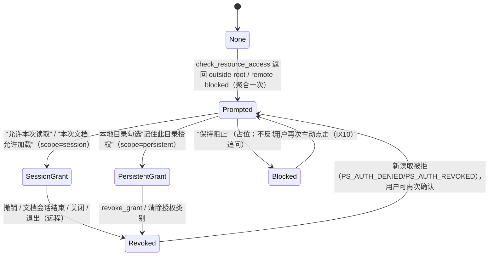

### 8.2 决策/转换表

| 授权类型 | 获取方式 | 默认作用域 | 持久化 | 撤销效果 | 引用 |
|---|---|---|---|---|---|
| 单文件读取 | 用户打开该文件（dialog/drop/CLI/system/tree/recent） | 按文档记录、可撤销 | `kind=file, scope=persistent` | 停止该文件新读取；已加载内容保留或关闭 | R25；data-model §3.2 |
| 目录读取（根） | 打开目录 或 越界资源确认“允许本次/记住” | session；勾选才 persistent | 见 data-model §3.2 | 停止新读取/扫描/资源加载；不清最近列表 | R25；IXD §12.1 |
| 远程图片会话 | “本次文档允许加载” | 仅当前文档会话 | `kind=remote, scope=session, sourceDocId` | 取消在途请求、卸下资源回阻止占位、删除会话缓存 | R26；IXD §12.2 |
| 越界资源确认 | 聚合提示（非逐图弹窗） | session | 复选框默认不选 | 拒绝只影响对应目标 | R25；IXD §12.1 |
| 撤销后重试读取 | 新读取 | — | — | `PS_AUTH_REVOKED`；不通过重试偷偷恢复授权 | R07；IXD §11.1 |
| 启动复核 | 应用启动 | — | session 行全部删除；persistent 逐条复核 | 失败保持记录并标不可用，使用时重新确认 | R25；data-model §3.2 |

### 8.3 不变量（测试 oracle）

- INV-AZ-01 单文件打开只授予该文件读取；不得因此获得目录或网络权限（R25）。
- INV-AZ-02 越界本地资源确认按目录一次聚合，显示规范化范围与数量；不得逐图弹框。
- INV-AZ-03 额外目录授权默认 session；“记住”默认不选；远程授权仅文档会话级（SRS §6.1）。
- INV-AZ-04 权限判定只在 Rust 侧基于注册表完成；界面传来的路径不是凭证（R25/security-model §2）。
- INV-AZ-05 拒绝只影响对应目标：占位保留、正文可读、不重复追问；仅再次主动点击重开确认。
- INV-AZ-06 撤销本地授权立即停止新读取/扫描/资源加载；已加载内存内容可继续；新会话不得靠缓存绕过授权（AT25）。
- INV-AZ-07 撤销远程授权取消在途请求、卸下对应资源回阻止占位、删除对应会话缓存。
- INV-AZ-08 持久目录权限与当前文档临时权限不可互相替代；历史返回不复用已失效的临时网络许可（SRS §5.2）。
- INV-AZ-09 会话级授权随应用启动清除；持久授权逐条复核存在性与系统权限。
- INV-AZ-10 最近列表不得作为隐性授权来源；清除授权后不得自动重新授予。
- INV-AZ-11 重定向到未确认域/私网地址必须阻止并重新确认，不自动扩大范围（AT26）。

### 8.4 参数与来源

| 参数 | 值 | 来源 | 性质 |
|---|---|---|---|
| 远程授权粒度 | 文档会话 | SRS §6.1 | 冻结默认 |
| 目录授权默认 | session；持久需显式勾选 | SRS §6.1 | 冻结默认 |
| 远程获取上限 | 单响应 ≤20MiB；连接 5s；总 15s；重定向 ≤3 跳 | security-model §4 | 初始可校准 |
| 单图预算 | 20MiB / 32MP | SRS §6.1 | 冻结初始预算 |

## 9. 持久写回抑制（R27/IX12 §14.3）

覆盖：R27；AT27；IXD §12/§14；data-model §6；contract `clear_records`/`resume_recording`。

### 9.1 状态图与写入门禁

写入门禁（逐字承接 data-model §6）：

- `recents | positions | session`：允许写入 ⇔ `rememberRecords=true` ∧ `session_suppressed(category)=false`
- `cache`、`authorizations`：正常可写；`logs`：不在本门禁内。

```mermaid
stateDiagram-v2
  [*] --> Writable
  Writable --> Suppressed: clear_records(confirm=true)（recents/positions/session）
  Suppressed --> Writable: resume_recording(类别) 或 显式打开文档（entry != restore）
  Writable --> BlockedByPref: rememberRecords=false
  BlockedByPref --> Writable: 用户重新开启“记住记录”
  note right of Suppressed: 抑制期间写请求返回 SaveResult{saved:false}，不报错、不写库
```

### 9.2 分类清除结果表

| 类别 | 数据库/文件 | 运行时效果 | 抑制规则 | 引用 |
|---|---|---|---|---|
| recents | `recents`（选中或全部） | 列表移除 | 停止后续写入直至恢复/显式打开 | R27；IXD §12 |
| positions | `positions` | 下次不恢复位置 | 当前会话停止写回（滚动/后台/退出都不得重建） | R27；IXD §14.3 |
| session | `session_tabs`/`session_meta`/`sidebar_state` | 下次不恢复会话 | 同上 | R27；IXD §14.3 |
| cache | `cache_meta` + `remote-images/` | 移除可重建缓存；内存中合法视图可继续 | 不破坏偏好 | R27；IXD §14.1 |
| authorizations | `authorizations`（选中或全部） | 与 revoke 一致：停止新读取；不自动从最近重授 | — | R25/R27 |
| logs | `logs/` 指定文件 | 移除日志；不上传 | — | R27/R28 |

清除协议：显示类别、数量/空间与“不会删除原始文档”；`confirm=true` 才执行；逐类返回实际结果（数量或 `error`）；取消无变化（R27/IXD §12）。`rememberRecords=false` 提供独立“清除已有记录”入口，关闭记录不自动承诺清除历史（R27）。

### 9.3 不变量（测试 oracle）

- INV-WB-01 清除 recents/positions/session 后，在显式重新打开（entry≠restore）或 `resume_recording` 之前，相应类别写入必须 `saved:false`。
- INV-WB-02 后台任务、滚动、标签切换、退出自动保存不得在抑制期内重建被清除的记录（AT27）。
- INV-WB-03 抑制仅阻止持久写入；正文阅读、内存导航、会话内搜索不受影响。
- INV-WB-04 `rememberRecords=false` 与清除抑制是两个独立条件；显式打开不覆盖 `rememberRecords=false`。
- INV-WB-05 清除需 `confirm=true`；取消产生 0 变化。
- INV-WB-06 逐类别报告实际结果；部分失败必须暴露对应 `error`，不得显示“全部已清除”。
- INV-WB-07 清除授权类的运行时效果与 `revoke_*` 一致；不得从最近列表自动重新授予。
- INV-WB-08 清除操作不触碰源文件与源目录（R04/NF01）。
- INV-WB-09 数据库失败不静默丢状态：允许不持久化阅读降级并提示（NF08；IXD §11.1）。

### 9.4 参数与来源

| 参数 | 值 | 来源 | 性质 |
|---|---|---|---|
| 最近列表上限；磁盘缓存上限；日志滚动上限 | 100；256MiB；10MiB | SRS §6.1 | 冻结默认/预算 |

## 10. 启动恢复流程（R06/IX13）

覆盖：R06；AT06；IXD §14.2；architecture §5.8；contract `take_pending_open_requests`/`load_session`/`load_position`。

### 10.1 流程图

```mermaid
flowchart TD
  A[应用启动] --> B{take_pending_open_requests 有明确参数?}
  B -->|有| C[open_documents(entry=cli/system) 优先展示参数文件]
  B -->|无| D{restoreSession=true?}
  D -->|否| E[欢迎页 UI00]
  D -->|是| F[load_session：标签顺序与活动标签]
  C --> G[load_session 恢复其余合法标签（不得抢参数文件焦点）]
  F --> H[逐标签独立恢复]
  G --> H
  H --> I{文件存在且授权有效?}
  I -->|否| J[该标签标不可用/提示重新确认；不阻塞其他文档]
  I -->|是| K[read_document(restore) + load_position：同版本/唯一匹配→精确，否则近似]
  J --> O[重新 watch_document 注册；恢复不抢占用户已发生的焦点/操作]
  K --> O
```

### 10.2 决策/转换表

| 情形 | 条件 | 动作 | 用户可见结果 | 引用 |
|---|---|---|---|---|
| 明确参数优先 | CLI/系统打开/第二实例传入路径 | 先展示该文件；再恢复其他合法标签 | 参数文件在前台并获焦点 | R06；IXD §14.2 |
| 无参数 | 无显式路径 | 按恢复偏好载入上次标签与位置 | 恢复会话；或 UI00（restore=false） | R06；AT06 |
| 单文档失败 | 文件缺失/权限撤销 | 该标签标不可用；提示重试/重选；其余继续 | 失败互不阻塞 | R06；AT06 |
| 授权已撤销 | 持久授权失效 | 使用时重新确认；不自动授予 | 提示重新确认 | R25；data-model §3.2 |
| 位置恢复 | 同版本/唯一匹配 | 精确；否则近似 | 不阻塞其他标签恢复 | R19 |
| 恢复条目 | `entry="restore"` | 不重启记录（不解除写回抑制） | 被清除会话不得被恢复悄悄重建 | contract §2.1；R27 |
| 恢复更新模式 | 新恢复的会话 | 使用全局默认值 | 不继承上次临时覆盖 | IXD §14.2 |
| 焦点 | 恢复全过程 | 不抢用户已发生的焦点/操作 | 后台标签/晚完成任务不夺焦 | IXD §4.2/§14.2 |

不恢复清单（必须为“不恢复”）：查询、选区、当前文档级设置覆盖、临时网络授权（IXD §14.2；SRS §5.2）；会话保存仅元数据与锚点（R06；data-model §3.4）。

### 10.3 不变量（测试 oracle）

- INV-SR-01 显式启动参数优先于会话恢复展示并获得初始焦点。
- INV-SR-02 恢复逐文档独立：单个文件失败只影响该标签，其他标签继续。
- INV-SR-03 查询、选区、当前文档级覆盖、临时网络授权不恢复。
- INV-SR-04 恢复会话使用全局默认更新模式，不继承上次临时覆盖。
- INV-SR-05 `entry="restore"` 不解除写回抑制、不重建被清除会话（R27）。
- INV-SR-06 恢复过程与恢复任务晚完成不得抢占用户已发生的焦点/操作。
- INV-SR-07 恢复位置遵守模型 6 的精确/近似判定；单个失败不阻塞其他恢复。
- INV-SR-08 恢复后必须重新建立 `watch_document` 注册（监测不持久化）。

### 10.4 参数与来源

| 参数 | 值 | 来源 | 性质 |
|---|---|---|---|
| 启动恢复开关 | `restoreSession=true` | SRS §6.1 | 冻结默认 |
| 记录开关 | `rememberRecords=true` | SRS §6.1 | 冻结默认 |
| 恢复并发 | 待验证参数；建议逐标签串行（并发 1） | 来源未规定 | 待验证（理由：避免焦点与资源竞争、失败隔离简单；见 §11 P-03） |

## 11. 待验证参数清单（不构成验收阈值）

- P-01 每标签历史容量上限：建议 100 条/标签（§5.4；来源未规定；理由：与最近列表同量级、内存可控）。
- P-02 布局稳定校正延迟：建议 200ms（100–300ms）（§6.5；理由：等待重排/字体/图片解码稳定）。
- P-03 恢复并发：建议逐标签串行（1）（§10.4；理由：避免焦点与资源竞争）。
- P-04 窗口聚焦复核节流：建议 300ms（§3.4；理由：防止焦点抖动引发重复读取）。

纪律：以上参数在固定并复跑（NF11）前不得作为回归依据；已冻结数字以 SRS §6.1、contract §7、security-model §4 为准，修改时同步更新交互/帮助/验收（SRS §6.1 前言）。

## 12. 追溯摘要

- §1 会话状态机：R01/R03/R07/R21/R29；AT01/03/07/21/29；IX01/08/09/15；IXD §16.1；contract §2.1/§5/§6；SRS §6.3。
- §2 版本提交：R22；AT22；IX08/IX09；IXD §20.3；contract §6。
- §3 监测/稳定/复核：R21/R22；AT21/AT22；IX08；contract §7。
- §4 更新模式：R21；AT21；IX08；IXD §10.2/§16.2；SRS §6.1。
- §5 导航历史：R14/R15/R16；AT14/15/16；IX03/IX04；IXD §6/§7；SRS §5.2。
- §6 锚点：R19；AT19；IX03/IX08/IX13；IXD §6.4/§10.3；data-model §3.3；contract §3.4。
- §7 标签生命周期：R05；AT05；IX02；IXD §5.3；SRS §5.2/§6.1；contract §2.1。
- §8 授权生命周期：R25/R26；AT25/AT26；IX10；security-model §2–§4；data-model §3.2。
- §9 写回抑制：R27；AT27；IX12/IX13；IXD §14.3；data-model §6；contract §2。
- §10 启动恢复：R06；AT06；IX13；IXD §14.2；contract §2；架构 §5.8。

## 开放项（交 Stage Orchestrator）

> 以下为本模型执行中发现的口径缺口/需要裁决项；不直接向用户提问，由 Orchestrator 按澄清门处理。未选项不代表任何决定。

- **OI-01（状态枚举缺口）**：IXD §16.1 未列“尚未加载任何版本即读取失败”的状态（本模型命名 LoadFailed）；contract §6 的 `DocumentSession.status` 字段也未定义枚举。建议由架构/UI 规格补充 `status` 枚举（或明确以诊断维度 D6 表达）。影响：实现与测试对“打开失败标签”的状态与文案归属。
- **OI-02（接受候选 vs 预派发任务）**：按 contract §6.1+§6.3 字面解释，“接受新的待更新候选”使代次递增，因此接受前派发的 pending 版本解析结果在“接受”时全部失效；本模型按严格解释建模（接受后重新派发）。若架构意图为“接受时可采用既有解析结果”，需在契约修订（r2）中增加明确规则。影响：实现成本与 AT22 测试构造。
- **OI-03（聚焦复核范围）**：contract §7.5 “对活动标签与全部可见文档”范围不完全明确（活动标签＋全部已打开标签？还是仅前台可见？）。本模型按“活动标签＋全部已打开标签，后台结果仅暂存、激活后处理”解释。影响：后台标签的读取时机与资源开销。
- **OI-04（写回抑制粒度）**：data-model §6 “显式打开文档恢复相应类别”未说明粒度（按类别全局 vs 按文档）。本模型按“类别全局抑制＋显式打开（entry≠restore）恢复 recents/positions/session”解释（与 AT27“仍打开的页面不立刻写回”一致）。影响：清除后首个显式打开前的写入 oracle。
- **OI-05（源不可用/撤销后的候选提交）**：候选已稳定读取后源文件被删除或授权被撤销时，“现在更新”是否仍可提交该内存候选（提交不发起新磁盘读取）。本模型暂定“可提交、不发起新读取”；请产品/架构确认。影响：R07 与 R21 组合场景。
- **OI-06（文案上下文）**：精确/近似文案存在两套上下文——更新流（IXD §10.3/§16.2：“已更新，已保持阅读位置”/“已更新，位置近似恢复”）与导航返回流（IXD §6.4：“已恢复阅读位置”/“文档已更新，已恢复到相近章节”）。本模型并列固化，建议确认 i18n 键归属，避免实现自选。
- **OI-07（待验证参数）**：P-01–P-04 为来源未规定的参数（§11）；在校准并固定前不得作为测试回归依据（NF11；A8）。
