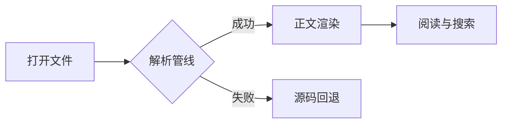

# PaperStack 阅读样例（修订版）

这是混合中文/English 的最小样例文档，用于验证解析管线、公式、代码、图表、
图片占位与宽内容局部滚动。文档不会被修改。

## 数学（修订版）

行内公式：质能等价 $E = mc^2$，以及带下标的变量 $x_{i+1}$。

块公式（改写）：

$$
\int_0^1 x^2 \, dx = \frac{1}{3}
$$

未知宏公式（应只影响本公式并显示源码占位）：$\undefinedmacro{x}$

## 代码与任务

```rust
/// 计算斐波那契数列的前 n 项。
fn fib(n: u32) -> Vec<u64> {
    let mut seq = vec![0, 1];
    for i in 2..n as usize {
        let next = seq[i - 1] + seq[i - 2];
        seq.push(next);
    }
    seq.truncate(n as usize);
    seq
}
```

任务列表（只读复选框）：

- [x] 解析 Markdown 结构
- [x] 渲染公式与代码
- [ ] 阅读位置恢复（后续任务）

## 图表



## 图片

缺失图片应显示块内占位，而不是空白或报错弹窗：


## 宽表格

| 语言 | 首次出现 | 动态导入 | 未知降级 | 行号复制 | 主题 | 备注 | 覆盖 |
| --- | --- | --- | --- | --- | --- | --- | --- |
| C | v0.1.0 | 按需 | 纯文本 | 不参与 | github-light | 首批语言 | 12 |
| C++ | v0.1.0 | 按需 | 纯文本 | 不参与 | github-light | 首批语言 | 12 |
| Python | v0.1.0 | 按需 | 纯文本 | 不参与 | github-light | 首批语言 | 12 |
| Rust | v0.1.0 | 按需 | 纯文本 | 不参与 | github-light | 首批语言 | 12 |
| Java | v0.1.0 | 按需 | 纯文本 | 不参与 | github-light | 首批语言 | 12 |
| JavaScript | v0.1.0 | 按需 | 纯文本 | 不参与 | github-light | 首批语言 | 12 |
| TypeScript | v0.1.0 | 按需 | 纯文本 | 不参与 | github-light | 首批语言 | 12 |
| Bash | v0.1.0 | 按需 | 纯文本 | 不参与 | github-light | 首批语言 | 12 |

## 嵌套小节

### 三级标题

- 列表项一
- 列表项二，包含 **加粗**、*斜体* 与 `行内代码`。

> 引用块：原始 HTML、事件属性与 style 都会被消毒处理。
