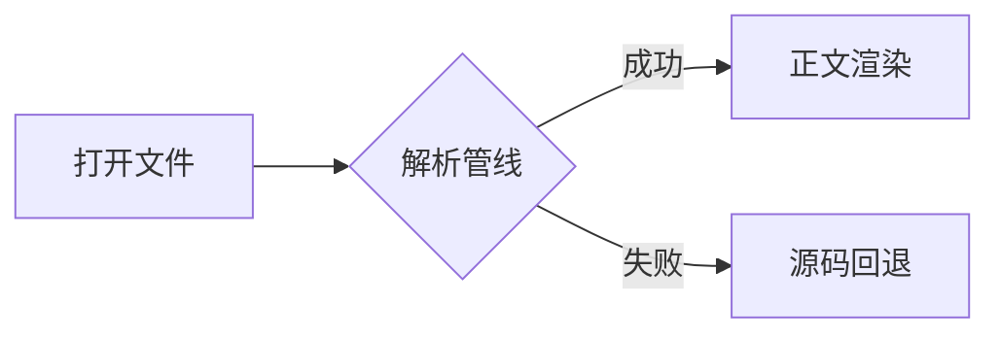
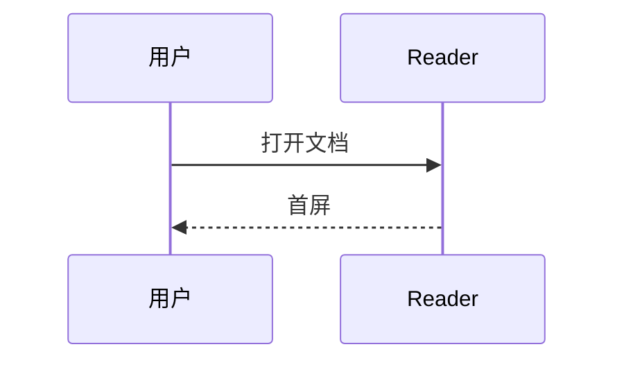
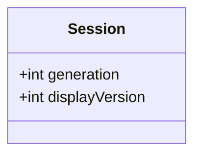
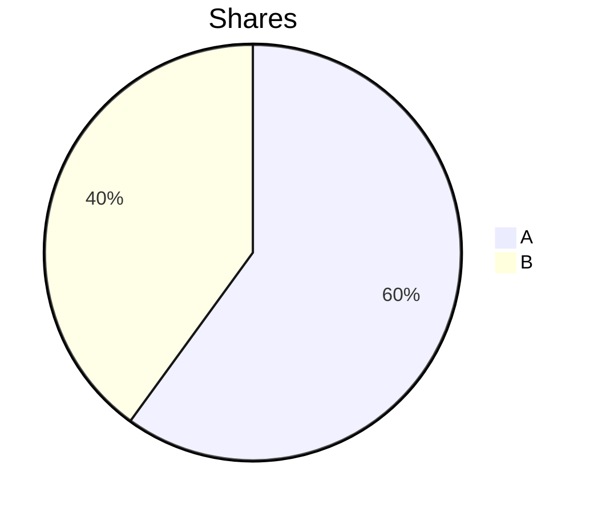

# Mermaid samples (rendering-pipeline §2.10)

Flowchart (supported):



Sequence diagram (supported):



Class diagram (supported):



Syntax error must stay local (source fallback + diagnostics):

```mermaid
flowchart LR
  A[unclosed --> B[[[
```

Unsupported diagram type (pie) must show the supported-range explanation,
not a crash:


