# Malicious samples (security-model §5; T-59)

Inputs are hostile by construction; the pipeline must sanitize, isolate or
refuse — never execute, never write. This file is test data.

style injection

<iframe src="https://example.invalid/frame"></iframe>

<a href="javascript:window.__pwned=true">javascript url</a>

<a href="data:text/html;base64,PHNjcmlwdD5hbGVydCgxKTwvc2NyaXB0Pg==">data url</a>

<a href="vbscript:msgbox(1)">vbscript url</a>

[path traversal link](../../../../etc/passwd)

[windows traversal link](..\\..\\..\\Windows\\System32\\drivers\\etc\\hosts)

<svg xmlns="http://www.w3.org/2000/svg" onload="window.__pwned=true"></svg>

`<script>` inside inline code stays literal text and must not open a tag.

Macro bomb (KaTeX expansion limits must isolate this formula):

$$
\def\bomb{\bomb\bomb}\bomb
$$

Mermaid node overflow (must hit the node/time cap, not freeze):

```mermaid
flowchart LR
  n0 --> n1
  n1 --> n2
  n2 --> n3
  n3 --> n4
  n4 --> n5
  n5 --> n6
  n6 --> n7
  n7 --> n8
  n8 --> n9
  n9 --> n10
  n10 --> n11
  n11 --> n12
  n12 --> n13
  n13 --> n14
  n14 --> n15
  n15 --> n16
  n16 --> n17
  n17 --> n18
  n18 --> n19
  n19 --> n20
  n20 --> n21
  n21 --> n22
  n22 --> n23
  n23 --> n24
  n24 --> n25
  n25 --> n26
  n26 --> n27
  n27 --> n28
  n28 --> n29
  n29 --> n30
  n30 --> n31
  n31 --> n32
  n32 --> n33
  n33 --> n34
  n34 --> n35
  n35 --> n36
  n36 --> n37
  n37 --> n38
  n38 --> n39
  n39 --> n40
  n40 --> n41
  n41 --> n42
  n42 --> n43
  n43 --> n44
  n44 --> n45
  n45 --> n46
  n46 --> n47
  n47 --> n48
  n48 --> n49
  n49 --> n50
```

Task checkbox click attempt (must stay disabled):

- [ ] attacker toggles me
